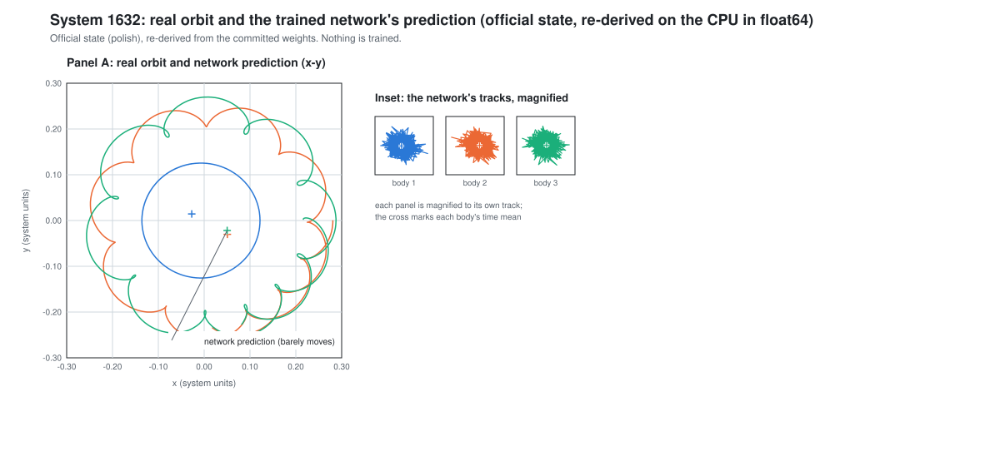

**Audience:** the project owner, a first-year student; no specialist background assumed.

**What this page rests on.** The sealed stop handoff, `.planning/phases/60-single-system-learnability/evidence/g2/stop-handoff.json`, SHA-256 `7ed8223c066e62bd55e527dc703565367a0f9764a253e086a3bc0b4e719d02d5`. The number manifest, `evidence/numbers.json`, SHA-256 `632e02b21d1ee132f844e5c9592578d5ce32bb31b9673ccb76dc84556511cafa`. Every number below is taken from that manifest and re-derived by `evidence/verify_phase64_verdict.py`; none is typed by hand.

**Status.** `awaiting-owner`. The agent's recommendation is `change-course`. The owner's decision is recorded at checkpoint ①, below, and is still pending.

## In plain language

This page answers one question: can this project work? It reports what the experiments found, what the rule agreed in advance says about that, and what the owner is asked to decide. It trains nothing and it does not spend the held-out exam.

1. **The network did not reproduce any of the three orbits.** Each experiment is a *Rung*: one exam on the project's ladder. Rung 1 is the easiest, training the network on a real orbit together with the correct answer and then asking it to reproduce that same orbit. Three systems (1632, 851 and 4658) were each trained once, for 2.573 to 5.693 hours. All three ended at **Tier 0**. A *tier* is the scorecard's grade for a prediction, and Tier 1 is the lowest passing grade. Tier 1 needs **E**, the worst position error over the window as a fraction of the system's size, to be at most 0.1 (10%). The three runs ended with E of 1.1574, 1.2375 and 1.1432, about 11 to 12 times the Tier-1 line. The **valid horizon** is the fraction of the window before the error first exceeds 1% (or 10%); it was 0.0 at both limits on all three, meaning the prediction was outside both limits at the first scored time. **eps_h** is the largest relative energy drift along the predicted path: Tier 2 needs E at most 0.01 and eps_h at most 10⁻³; Tier 3 needs E at most 0.01 and eps_h at most 10⁻⁵.
2. **Gate G2 fired, and the pre-agreed sweep rescued nothing.** *Gate G2* is the stop rule agreed before any result: it fires when two or more of the three systems end below Tier 1, and all three did. The *settings sweep* is the one rescue the rule allows: four other values of the network's first-layer frequency setting, `first_omega_0` (60, 120, 240 and 480), on one failing system, 1632, where the project had locked the value 30. All four also ended at Tier 0, with E between 1.1539 and 1.1575. A rescue needed one of them to reach Tier 1; none did, so nothing was confirmed on system 851 and the owner was not called to the checkpoint that asks whether to continue at a new setting.
3. **The frozen rule's output is RETHINK-REPRESENTATION.** Given only "G2 fired and the sweep rescued nothing", the decision rule frozen in Phase 59 returns that label. It is the rule's output, not a Phase 64 judgement, and this page does not amend it.
4. **The evidence beside the label.** The trained networks behave as *time-constant predictors*: each returns essentially each body's average position and nothing that moves, with E of 1.1538, 1.2337 and 1.1396 on the three systems on the CPU in double precision (re-derived (CPU float64)), and an output that moves by only 0.0030 to 0.0034 of the real orbit's own variation about its mean. Their accuracy curves levelled off early: E fell by a factor of 25 to 48 in the first 5% of training (the decision context rounds this to 25- to 50-fold), then settled at 1.14 to 1.24, about 11 to 12 times the Tier-1 limit. Two comparison points frame the result: the *two-Kepler formula*, a no-learning baseline that places each body on the two-body orbit implied by its initial state, and the *nearest-neighbour copy*, which repeats the closest training orbit instead of predicting. Both are scored in the same physical units in `## Comparison points`.
5. **What was not run is not called failed.** Rung 2, which would ask whether the network can learn an orbit from the physics alone, is recorded with the reason "no rescue"; the two hard-stage probes are recorded the same way; Phases 61 to 63 are "skipped at G2, not failed"; Level 3 of the readiness ladder is "not tested (skipped at G2)"; and the control has no readout branch because Phase 63 was skipped at G2.
6. **What it cost.** 22.378 hours of arm wall time: 11.108 hours for Rung 1 and 11.270 hours for the sweep. One single-orbit experiment costs 2.573 to 3.046 hours for an unextended arm and 5.693 hours for the arm that earned its doubling. All computation runs on this Mac (standing owner rule, `PROJECT.md` Constraints, reaffirmed 2026-10-25).

The rule and the evidence sit side by side. Neither column is softened, and neither is allowed to overwrite the other.

| What the pre-registered rule says | What the evidence shows |
|---|---|
| **RETHINK-REPRESENTATION**, for "G2 fired and the sweep rescued nothing". The label is quoted exactly as the sealed handoff records it; it is not amended, softened or relabelled. | Every trained network learned only each body's average position: it is a time-constant predictor, with E of 1.1538, 1.2337 and 1.1396 on the three systems (re-derived (CPU float64)). Its accuracy curves levelled off early: E fell by a factor of 25 to 48 in the first 5% of training (about 25- to 50-fold as the decision context puts it), then settled at 1.14 to 1.24, about 11 to 12 times the Tier-1 limit. The sweep varied only `first_omega_0`; each arm's step budget followed its own measured speed under the pre-registered rule (the Budget row of `60-RUN-PROTOCOL.md`), 842,770 to 994,807 steps across the four sweep arms, so `first_omega_0` was the only setting chosen. The records cannot yet tell a design limit from a limit of the fixed training recipe. |

At checkpoint ① the owner is asked one question: continue on this path, change course (the agent's recommendation), or stop. If the project continues, the next milestone is v2.5, committed only to its name and its first phase, the trainex-r5 research round.

The cost of reaching the next level cannot be estimated from this evidence; `### Cost to the next level` under `## Cost on this Mac` states why, and what would measure it (GAP-64-03).

## The result under the pre-registered rule

The sealed handoff records the frozen rule's output as a small dictionary. Quoted exactly as recorded:

| Field | Recorded value |
|---|---|
| `verdict` | `RETHINK-REPRESENTATION` |
| `reason` | `G2 fired and the sweep rescued nothing` |
| `qualifier` | `false` |

The rule was given only those inputs. Re-running the frozen `decision_verdict` on the committed inputs returns the same dictionary — the `inputs` mode prints INPUTS-OK — so the label is reproducible from the sealed files rather than recalled from memory. Nothing pre-registered changes and the label is not amended; amending it after seeing the result would need a formal amendment with the owner's sign-off (SCOPE-42, SCOPE-43).

**The qualifier field, plainly.** `representation_limit_qualifier` is reported exactly as recorded: `false`. Here `false` means "not evaluated on this branch", not "the condition failed": the frozen rule returns `false` on the G2 path without evaluating the qualifier, and it refuses a Rung 1 comparison input on that path. The amendment's text applies the qualifier whatever the branch, so the two do not conflict in substance. On the committed numbers the qualifier's condition holds anyway: Rung 1 is Tier 0 on all three systems, and its E is below the two-Kepler formula's only on system 4658, 1 of 3. This page does not recompute or change the field.

## What each rung reached, and where along the window it broke

Seven arms ran: three at the locked setting (Rung 1) and four in the G2 settings sweep. The table is the official result of each arm, scored on this Mac's MPS device in single precision (official (MPS float32)); rows are in the sealed handoff's order.

| Arm | System | first_omega_0 | Official state | Tier | E | eps_h | Formula E | Below formula? | h at 1% | h at 10% |
|---|---|---|---|---|---|---|---|---|---|---|
| r1-1632 | 1632 | 30 | polish | 0 | 1.1574 | 705.69 | 0.9168 | no (Tier 0) | 0.0 | 0.0 |
| r1-851 | 851 | 30 | adam | 0 | 1.2375 | 165.50 | 0.4312 | no (Tier 0) | 0.0 | 0.0 |
| r1-4658 | 4658 | 30 | adam | 0 | 1.1432 | 13,127.5 | 1.9697 | yes (Tier 0) | 0.0 | 0.0 |
| g2s-1632-w060 | 1632 | 60 | adam | 0 | 1.1569 | 4,052.3 | 0.9168 | no (Tier 0) | 0.0 | 0.0 |
| g2s-1632-w120 | 1632 | 120 | adam | 0 | 1.1561 | 1,342.9 | 0.9168 | no (Tier 0) | 0.0 | 0.0 |
| g2s-1632-w240 | 1632 | 240 | adam | 0 | 1.1539 | 123.62 | 0.9168 | no (Tier 0) | 0.0 | 0.0 |
| g2s-1632-w480 | 1632 | 480 | adam | 0 | 1.1575 | 4,170.1 | 0.9168 | no (Tier 0) | 0.0 | 0.0 |

**Where along the window it broke.** Re-derived on the CPU in double precision (re-derived (CPU float64)) over the 1,001 scored times: the system error at the first scored moment is 0.805 to 1.009 and the inner-pair error 0.894 to 0.998; the best moment anywhere in the window is 0.817 to 0.935; and 0 of 1,001 times fall within the Tier-1 limit. Every arm was already outside both the 1% and 10% limits at the first scored moment, which is why both valid horizons read 0.0.

**What did not run, and why.** Rung 2 and the two hard-stage probes are recorded with the reason `no rescue`. Phases 61 to 63 are `skipped at G2, not failed`. The control has no readout branch because Phase 63 was skipped at G2. None of these is a failure: the exam was never given.

## The best ε_H against the locked bar

eps_h is the largest relative energy drift along the predicted path. The best official reading is 123.62 (official (MPS float32)), from arm g2s-1632-w240. The locked Tier-3 bar is 10⁻⁵, so the best official reading is about 1.24 × 10⁷ times the bar. Two more favourable readings are footnoted so the headline cannot look chosen: 30.29 on r1-1632's Adam state, and 0.9999 on r1-4658's trace at step 1,863,178. Neither is the official result of its arm: the scorecard's rule takes the better state by lowest E and then lowest energy drift, and the official states are the ones in the table above.

**A caution that belongs beside the number.** eps_h is not a measure of correctness for a near-constant predictor: a path that barely moves can have a small relative energy drift while its positions are wrong. The 10⁻⁵ bar therefore does not rescue a prediction that fails E.

## Why every network scored like a constant: the time-constant evidence

The simplest predictor that learns nothing is each body's average position over the window. Scored with the frozen scorer, it is almost exactly what every trained network does.

| System | Constant predictor E (re-derived (CPU float64)) | Rung 1 official E (official (MPS float32)) | Arm |
|---|---|---|---|
| 1632 | 1.1538 | 1.1574 | r1-1632 |
| 851 | 1.2337 | 1.2375 | r1-851 |
| 4658 | 1.1396 | 1.1432 | r1-4658 |

Across the seven arms the official E exceeds the constant predictor's by 0.0035 to 0.0038. Two ratios make the same point over the 14 arm states. The *time-variation ratio* is the output's movement about its own mean divided by the real orbit's movement about its own mean: it is 0.0030 to 0.0034, so the network moves by only about three parts in a thousand of the orbit's own variation. The *rms ratio* is the output's RMS error divided by the orbit's RMS deviation about its own mean: it is 0.9999 to 1.0001, so the error is as large as the orbit's own variation. A predictor that returned the average position would land in the same place.

**Figure 1.** System 1632, arm r1-1632, official state `polish`, drawn read-only from the committed weights in CPU float64. The prediction barely moves; the error stays near the orbit's own scale. SHA-256 `d9754afaf0aefdf2c4b3f27dfc97b6cac06e4bac4adb63b5b5447efdd69a7695`.

**What this does not decide.** The records cannot distinguish a representation limit from the fixed recipe: they show how the runs ended, not whether the cause lies in the network's design, the training recipe or something else (60-VERIFICATION.md, the independent observation for Phase 64).

## Accuracy curves

Read the curves as convergence against training step, not as error along the window: they say how fast training settled, not how the prediction drifts in time. On the seven arms E started between 35.6 and 76.7, fell by a factor of 25 to 48 within the first 5% of training, and then settled: the final E is 1.14 to 1.24, about 11 to 12 times the Tier-1 limit. The curves levelled off early and stayed there. That is why no hours-to-the-next-level figure is projected: there is no measured rate of improvement to extrapolate.

| Curve fact | Range over the seven arms |
|---|---|
| E at step 0 | 35.6 to 76.7 |
| Fold drop in the first 5% of training | 25 to 48 |
| E after the first reading | 1.3 to 1.6 |
| E at the final step | 1.14 to 1.24 |
| Range after the first reading | 0.27 to 0.59 |
| Multiple of the Tier-1 limit at the final step | 11 to 12 |

## Comparison points

**The two-Kepler formula.** A no-learning baseline that places each body on the two-body orbit implied by its initial state. It scores E 0.9168, 0.4312 and 1.9697 on systems 1632, 851 and 4658. Over the training population its median E is 0.989 and over the validation population 0.940; it reaches Tier 1 on 1 of 1812 training panels and 0 of 227 validation panels.

**The nearest-neighbour copy.** It repeats the closest training orbit instead of predicting. Its validation median E is 2.135 and it reaches Tier 1 on 0 of 227 validation panels. Its population differs from Rung 1's, so read its median as indicative only.

**Breen et al. (arXiv:1910.07291).** Supervised training, equal masses, zero initial velocity and planar motion. Their energy error is of order 10⁻², reaching 10⁻⁵ only after a projection.

**Kollias and Matzakos (arXiv:2607.23501).** One network per periodic orbit. Their relative energy error over one period is 0.02–3% across their orbits: 7.74 × 10⁻⁴ on Euler, 3.23 × 10⁻² on Lagrange and 1.64 × 10⁻⁴ on figure-8. They train for 2 to 3 × 10⁵ Adam epochs and 1.5 × 10⁴ L-BFGS epochs.

arXiv:2503.04585 is mentioned only by its abstract, with no characterization of its data.

The metrics differ across these points — position error over a window, energy drift along a path, relative energy error over a period — so the comparisons are indicative, not like-for-like. No novelty claim is made for this work: it is a proof of concept, and each study is described in its own scope.

## The survey and the hard-stage probes

Phase 59's survey measured how fast a perturbation grows on each stage's systems. It is reported, not gating. The median error growth is 1.22 at Stage 0, 28.53 at Stage 4b and 351.6 at Stage 6; Stage 3 holds 0 systems, so the stage mapping beyond Stages 0 and 1 is owner-pending.

The two hard-stage probes would have trained `standard/base/2279` (Stage 4b) and `standard/base/3418` (Stage 6). Both are skipped with the reason `no rescue`, and neither was ever trained.

## Readiness ladder

The ladder names capabilities, not effort. Levels 2 and 3 can be reached in either order. The project's level is the highest one with every level below it also reached.

| Level | Capability | How it is shown | Status here |
|---|---|---|---|
| 0 | Data and specs exist | — | Reached |
| 1 | The training code runs | — | Reached, not to spec |
| 2 | The code provably matches the spec | CONF-10/11 pass, and a mechanical code-against-spec check passes | Not tested (skipped at G2) |
| 3 | Learns one system | Rung 2b counts on at least 2 of 3 (`2 of 3`) | not tested (skipped at G2) |
| 4 | Learns a small family | Rung 3 counts on at least 12 of 16 (`12 of 16`) | Not tested (skipped at G2) |
| 5 | Learns all of Stage 0 and predicts unseen Stage-0 systems | Full training; the validation panel at the charter's bar, beating the formula and the copy | Not reached |
| 6 | Passes the one-shot Stage-0 final exam | The preserved held-out evaluation, at the charter's bar | Not reached; the evaluation stays unspent |
| 7 | Stages 1–2 (stable) | Charter bars | Not reached |
| 8 | Stages 3–5 (chaotic) | Charter bars | Not reached |
| 9 | Stage 6 (near-collisions) | Charter bars | Not reached |

**Level 1** is therefore the highest level with every level below it reached. Levels 2 to 4 were not tested, so nothing above them can be claimed; Levels 5 to 9 were not reached. The held-out evaluation is preserved and unspent.

## Cost on this Mac

All computation runs on this Mac (standing owner rule, `PROJECT.md` Constraints, reaffirmed 2026-10-25). The machine is an Apple M5 Pro with 24 GB of memory. Every figure below is measured on it; none is projected from another machine.

**Hours spent.** 22.378 hours of arm wall time in Phase 60: 11.108 hours for Rung 1 and 11.270 hours for the sweep.

**Per-arm cost.** Wall hours are the record's measured arm wall time; timed seconds per step is the harness's timing run; sustained seconds per step is the arithmetic rate over the arm's steps.

| Arm | Wall hours | Timed s/step | Sustained s/step |
|---|---|---|---|
| r1-1632 | 2.573 | 0.013596 | 0.01164 |
| r1-851 | 2.842 | 0.011015 | 0.01042 |
| r1-4658 | 5.693 | 0.011013 | 0.01044 |
| g2s-1632-w060 | 2.730 | 0.011893 | 0.01080 |
| g2s-1632-w120 | 2.903 | 0.011303 | 0.01092 |
| g2s-1632-w240 | 3.046 | 0.010856 | 0.01100 |
| g2s-1632-w480 | 2.591 | 0.012815 | 0.01105 |

Across the arms the timed rate is 0.010856 to 0.013596 seconds per step and the sustained rate 0.01042 to 0.01164. One single-orbit experiment costs 2.573 to 3.046 hours for an unextended arm, and 5.693 hours for the arm that earned its doubling.

**The costed first step for v2.5.** For the trainex-r5 round, its computing need is not yet measured: it depends on which arms the round commissions, and the harness times each arm before fixing its budget. As a labelled illustration, not a plan, a 100,000-step data-only diagnostic arm would take about 0.3 hours at the median timed rate of 0.011303 seconds per step.

**For scale only.** Generation 7 ran at 12.3 seconds per step. At that rate, the 200,000 to 300,000 steps a full single-orbit training would need come to 28.5 to 42.8 days of nonstop computing. This figure is for scale only: it is not the cost of any arm above, and it is not a plan.

**Assumptions.**
- The wall hours and seconds per step come from the seven committed arm records and the sealed handoff, not from a fresh timing run.
- Generation 7's 12.3 seconds per step comes from a run that ended in a failed state at step 951, `runs/stage0-v23g7-seed42/status.json`, on device mps per that run's `summary.json` header, so it is a Mac measurement.
- The sustained rate is the arm's wall hours divided by its steps; it includes data loading and checkpointing, while the timed rate is the harness's short timing run.
- The v2.5 illustration uses the median timed rate and a round number of steps; the real round's budget is set per arm after its own timing run.
- The for-scale figure uses the 200,000 to 300,000 step counts recorded in the planning documents, not a measured step count for this network.

**Hours to the next level are not projected**, because the curves levelled off far above Tier 1.

### Cost to the next level

The cost of reaching the next level is not estimable from this evidence.

The reason: the accuracy curves levelled off early and settled at about 11 to 12 times the Tier-1 limit, so there is no measured rate of improvement to extrapolate. Any hours figure for the next level would be invented, not measured.

What would measure it: the costed v2.5 first step given above. The trainex-r5 round times each arm before fixing its budget, so its first measured hours figure will come from that round, not from this page.

This subsection is how the verdict meets the next-level cost item of ROADMAP criterion 3 and FEAS-06, "the estimated cost to the next level". GAP-64-03 records the reconciliation: the criterion's literal sentence holds wording the owner's standing rule keeps out of this page, so the verdict states the item in this form instead. The ROADMAP and REQUIREMENTS text is unchanged.

## Candidate fixes for the next milestone (unranked)

These are the candidate fixes the next milestone may test. They are unranked: trainex-r5 ranks them, not this phase. Four are pre-registered design changes and four are untested recipe suspects.

- **Time-windowed networks.** Train on short windows and roll the prediction forward, so the network is never asked for the whole orbit at once.
- **A different output frame.** Predict a frame that moves with the system instead of absolute positions.
- **New input features or architecture.** Give the network features or a structure that can represent motion.
- **A shorter window.** Reduce the window the network must cover in one pass.
- **Learning rate.** The recipe suspect the sweep did not vary.
- **Optimizer.** Adam and the L-BFGS polish are the only two tried.
- **Schedule.** The step budget and the polish schedule were fixed, not tuned.
- **Network depth.** The architecture's depth was fixed at the locked design.

## The next milestone

The next milestone is v2.5, committed only to its name and its first phase: the trainex-r5 research round. It is open-book (Route B), diagnosis first, on why every trained network predicts a time-constant position. `/gsd-new-milestone` plans the later phases, and work continues in `.worktrees/trainex`.

## Your decision (owner checkpoint ①)

The question is the v2.4 proposal's own: continue on this path, change course, or stop. Each option carries its consequence.

| Option | What it means | Consequence |
|---|---|---|
| Continue on this path | The same design and the same training recipe. | The evidence above says the result would be the same kind of time-constant predictor; the held-out evaluation stays unspent until a later milestone spends it. |
| Change course (the agent's recommendation) | v2.5 opens with the trainex-r5 diagnosis round and runs no new long training until it explains the time-constant output. | It costs the diagnostic round first, and it is the only option that tests why the networks score like a constant before spending more hours. |
| Stop | The project ends here. | The held-out evaluation stays unspent; nothing further is trained. |

The recommendation is `change-course`, recorded in the front matter and pointing to the charter's V-1 row, which records the same three options for the owner's signature.

## Owner sign-off

- **Decision:** `change-course`
- **Date:** 2026-10-26
- **Meaning:** v2.5 opens with the trainex-r5 research round (open-book, diagnosis first) and runs no new long training until it explains the time-constant output.
- **Items left open:** all fourteen charter rows are recorded `open`, and no approved edit follows from any of them:
  - C-1, purpose (recorded, not asked again);
  - C-2, definition of done;
  - C-3, current level (recorded, not asked again);
  - C-4, the Stage-0 position criterion;
  - C-5, the Stage-0 energy criterion;
  - C-6, the `10⁻⁵` held-out bar;
  - C-7, GAP-59-08, how ε_H is measured;
  - C-8, the pass bars for Stages 1–6;
  - C-9, the budget;
  - C-10, the stop rule;
  - C-11, the evaluation section of `ctl_instruction.md` (recorded, not asked again);
  - C-12, PROJECT.md's What This Is and Core Value;
  - C-13, PROJECT.md's title line and Model constraint;
  - C-14, the requirements of the skipped phases (GAP-64-01).
- **Open rows carried as open:** because C-6 is `open`, this sign-off neither retains nor replaces the `10⁻⁵` held-out bar. Because C-7 is `open`, it does not settle GAP-59-08: how ε_H is measured stays undecided and GAP-59-08 stays open. Because C-12, C-13 and C-14 are `open`, PROJECT.md and the twelve skipped-phase requirement statuses are unchanged by this decision.
- **Record:** `.planning/phases/64-feasibility-verdict/64-CHECKPOINT-1-RULING.md`, SHA-256 `b0a80c114d1ddc7994c7e02abdd8105f7ae418c776981cf109951bb8f31fac82`.

## Evidence index

Every row is a committed file this verdict quotes, with its SHA-256 recomputed by `rules` on every run. The second table names the verifier modes and their success tokens.

| What | Path | SHA-256 | Checked by |
|---|---|---|---|
| The sealed stop handoff | `.planning/phases/60-single-system-learnability/evidence/g2/stop-handoff.json` | `7ed8223c066e62bd55e527dc703565367a0f9764a253e086a3bc0b4e719d02d5` | `inputs`, `frozen`, `rules` |
| G2 outcome | `.planning/phases/60-single-system-learnability/evidence/g2/g2-outcome.json` | `3e71568fe6d243f16dc930c7b8d49d028967b625e134cf5ba52d4c48b579c529` | `frozen` |
| Sweep curve | `.planning/phases/60-single-system-learnability/evidence/g2/sweep-curve.json` | `946c0bb9a658f287f074c8768c4cd4a54333df9c7303445fd5d64a5a347706bc` | `frozen` |
| Skip records | `.planning/phases/60-single-system-learnability/evidence/g2/skip-records.json` | `e15ad37d95e452637014f18c0eeb5d1795589717b6b82af14691bc3edd580bf8` | `frozen` |
| Rung 1, system 1632 | `.planning/phases/60-single-system-learnability/evidence/arms/r1-1632/record.json` | `a87273674785128714f5eae4981dcee31fe4c2332dbd84213b7aeaa0098da0b7` | `numbers` |
| Rung 1, system 851 | `.planning/phases/60-single-system-learnability/evidence/arms/r1-851/record.json` | `3152470de1b34f8e1aa4fe3c0a7f825c32da385eb7636db56a92da50a88baa8a` | `numbers` |
| Rung 1, system 4658 | `.planning/phases/60-single-system-learnability/evidence/arms/r1-4658/record.json` | `dbba558ab41b9b1ba080b8346fc4834dcd0987e046d151a4d443a8e5d94f1ab8` | `numbers` |
| Sweep, first_omega_0 60 | `.planning/phases/60-single-system-learnability/evidence/arms/g2s-1632-w060/record.json` | `cf1bc1fac780c21e26c917f4573c4845ccd36ed88136e23658f5a0eb5c960c42` | `numbers` |
| Sweep, first_omega_0 120 | `.planning/phases/60-single-system-learnability/evidence/arms/g2s-1632-w120/record.json` | `893cbcefbda4c8cb061071c6d12044620112750644d68987a3b57d55ea245900` | `numbers` |
| Sweep, first_omega_0 240 | `.planning/phases/60-single-system-learnability/evidence/arms/g2s-1632-w240/record.json` | `391e3f1728b3de287849ca4a7e48ae17da92e8ca48c8f77562caf377d56e4ca1` | `numbers` |
| Sweep, first_omega_0 480 | `.planning/phases/60-single-system-learnability/evidence/arms/g2s-1632-w480/record.json` | `b75905c954728001c27a4f9c649281feb7f404358d88a2cdd58822d94909639e` | `numbers` |
| The formula and copy baselines | `.planning/phases/59-read-only-baseline-scorecard/evidence/baselines/baselines.json` | `3d7b7a687091cf9b1b0d803849c227990e1d45aa82888bd3e91980e62fc92d9e` | `numbers` |
| The stage survey | `.planning/phases/59-read-only-baseline-scorecard/evidence/survey/survey.json` | `0e3295edff60c8e09c8e629b4b2a2d63a7e62d66d405e4c08db805120fa720a1` | `numbers` |
| The survey's probe picks | `.planning/phases/59-read-only-baseline-scorecard/evidence/survey/picks.json` | `b6836d5095edc12b9b7af873bfd5b6cb82fdeeb2e5c34e1c75b608810cda7317` | `numbers` |
| The Stage-0 census | `.planning/phases/59-read-only-baseline-scorecard/evidence/census/census.json` | `cf68e32d2a8b919dd1536a363aee2c6865b2841026263a3130e6edf8466dd034` | `numbers` |
| The frozen scorecard | `pinn/verification/artifacts/feasibility_scorecard_v1.json` | `f4b17688c05de68b7aa0f62e452baad751989b0ce2ce36828359a53f9e09444b` | `numbers`, `figure` |
| Generation 7's run status | `runs/stage0-v23g7-seed42/status.json` | `e7f43b9af426ac92e88489c27be8bc12a08644a2bb0748148534c9f818183f69` | `rules` |
| Generation 7's run header | `runs/stage0-v23g7-seed42/summary.json` | `b78e0686138de122e48ec3f7fd3d28839ac2885d7dd7b859b1e86cbc48a6fdba` | `rules` |
| The run protocol and its Budget row | `.planning/phases/60-single-system-learnability/60-RUN-PROTOCOL.md` | `d5d4298ca380b84b46f03300d7b33f70d65e8f630a44eecd61a1e4b4dafa8cd4` | `frozen` |
| The number manifest | `.planning/phases/64-feasibility-verdict/evidence/numbers.json` | `632e02b21d1ee132f844e5c9592578d5ce32bb31b9673ccb76dc84556511cafa` | `numbers` |
| The figure | `.planning/phases/64-feasibility-verdict/evidence/figure-1632.svg` | `d9754afaf0aefdf2c4b3f27dfc97b6cac06e4bac4adb63b5b5447efdd69a7695` | `figure` |
| The figure provenance | `.planning/phases/64-feasibility-verdict/evidence/figure-1632.provenance.json` | `409e5e87adc3729b4ae26d40b5b3f1fd6a68116cd0b842588fee9154f1d8bde0` | `figure` |

| Mode | Command | Success token |
|---|---|---|
| Rules | `python -B .planning/phases/64-feasibility-verdict/evidence/verify_phase64_verdict.py rules` | `RULES-OK` |
| Numbers | `python -B .planning/phases/64-feasibility-verdict/evidence/verify_phase64_verdict.py numbers` | `NUMBERS-OK` |
| Figure | `python -B .planning/phases/64-feasibility-verdict/evidence/verify_phase64_verdict.py figure` | `FIGURE-OK` |
| Inputs | `python -B .planning/phases/64-feasibility-verdict/evidence/verify_phase64_verdict.py inputs` | `INPUTS-OK` |
| Frozen | `python -B .planning/phases/64-feasibility-verdict/evidence/verify_phase64_verdict.py frozen` | `FROZEN-OK` |
