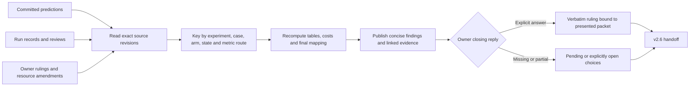

# Phase 69: Findings & Redesign Decision - Research

**Researched:** 2026-11-08
**Domain:** Committed experiment synthesis, historical recipe comparison, compute accounting and owner decision records
**Confidence:** LOW from the GSD provider seam, which has no repository-source authority class. Local observations below carry explicit file or command provenance; this is not a finding that the measurements are unreliable.
**Research baseline:** `46dfddfd52cabc4f90f8e89b52ccc1d6d967b0e2`. No training, source edits or owner decisions were performed.

<user_constraints>
## User Constraints (from CONTEXT.md)

The following material is copied verbatim from the implementation decisions, agent discretion and deferred ideas. [VERIFIED: .planning/phases/69-findings-redesign-decision/69-CONTEXT.md:54-185,295-312]

### Locked Decisions

<!-- DATA_ajs652rw_START -->
### Evidence and claim strength

- **D-01: Carry forward the decision delegation.** The owner chooses
  scope, resources, acceptable outcomes and the reserved closing decisions.
  Agents perform the scientific analysis and technical implementation
  choices. The owner's instruction to proceed accepts the evidence-first
  sequence, not a particular redesign or a new run. Do not conduct another
  scientific interview for questions the sources and delegation answer.
- **D-02: Separate the hypotheses and their measured scope.** Report the
  three original suspects, splitting the pipeline into training settings
  and physics terms, plus the original probe lead. DIAG-09 retained the
  adjacent-time association; its causal explanation remains open. The
  EXP-03 rate-improvement hypothesis being refuted is not a withdrawal of
  that original association. The successful smaller network refutes
  parameter shortage for the tested supervised one-orbit task, not for
  full Stage 0 or unseen initial conditions. The yardstick identifies a
  measurement defect; it does not establish which neural-network pass bar
  is achievable, nor explain the data-only mean-position failure.
- **D-03: Preserve the time and authority of each result.** Read the
  committed predictions, reviews and owner rulings, not just phase
  verification summaries. Historical Phase 65/67 pages correctly describe
  GAP-59-08 as open at their time; the current synthesis must also cite the
  later Phase 68 ruling closing it. Preserve the historical bytes instead
  of rewriting those pages. Quote registered labels faithfully, including
  the EXP-03 confirmed-worsening contrast and all unsettled/ambiguous
  contrasts. A positive control is not an isolated-factor experiment.

### Failed-versus-successful recipe reconciliation

- **D-04: Begin with the matched records already available.** Compare the
  v2.4 r1-1632 and r1-851 records with the corresponding locked-architecture
  EXP-03 lr1e-4 controls, preserving the repeat seed as additional evidence.
  Identify the same system/seed where available; do not silently equate
  4658 with 851 or treat a second seed as a second physical system. The
  comparison is retrospective and descriptive. Retain the original full
  prediction/review context for the controls, not just their endpoint E.
- **D-05: Verify comparability before interpreting the difference.** Trace
  the recorded revisions and compare the actual architecture, initialization,
  input/target preparation, body order, gauge, normalization, window/grid,
  sample selection, loss/reduction, optimizer policy, clipping, polish,
  precision/device, update budget and scored-state selection. Distinguish
  a checked equivalence, a checked difference and a source-unresolved
  comparison. Current code can help locate the recorded implementation,
  but cannot substitute for it when a revision changed. Existing field
  names, evidence readers and source hashes are preferred over a new
  general reporting framework.
- **D-06: Preserve the decisive known facts without selecting a cause.**
  The locked 12-layer, width-256, first-frequency-30 controls at constant
  Adam 1e-4 reached settled Tier 1 position fits on 1632/42, 851/42 and
  1632/41. The old runs used a cosine starting at 1e-3, clipping and
  polish; the new controls did not use clipping or polish. These facts
  make a training-recipe explanation worth examining and prevent a claim
  that only a smaller architecture can fit. They do not isolate the
  historical cause, prove energy accuracy or establish generalization.
  Compare final and intermediate recorded states where relevant without
  inventing unrecorded scores or selecting a new winner after results.
- **D-07: Make further compute conditional on its decision value.** First
  state what the existing comparison resolves. For each remaining question,
  explain whether different answers would change the recommendation, such
  as repairing a training recipe versus replacing the architecture. Only
  then recommend a focused prospective comparison if warranted. Describe
  the confounds it must control and the scope/resource decision needed.
  Do not specify unresearched numeric defaults, continue a frozen arm,
  silently insert a phase, or launch anything from this context. Any
  experiment design, budget and reading rule require the applicable
  prospective workflow and owner authorization.

### Findings, cost and requirement accounting

- **D-08: Keep the main findings readable and the detail auditable.**
  Lead with the plain-language answer and its uncertainty. Use a compact
  suspect/status/evidence presentation, with the registered predictions
  and detailed recipe comparison linked nearby. Keep the main findings
  to the roadmap's one-page intent; use supporting tables for detail
  rather than filling the main page with raw records. No new word-count
  rule is imposed. Every empirical claim must identify its committed
  source revision or digest. Separate observations, interpretations and
  proposed actions in the prose.
- **D-09: Account for measured work without implying unknown totals.**
  Derive v2.5 costs from unique existing run/attempt records and their
  documented timing bases. Include recorded diagnostic training, timing
  and other measured activities; include any recorded failed or partial
  attempt rather than counting successful rows alone. Preserve a missing
  duration as unknown. Do not add optimizer time to a wall that already
  includes it, count the same control through several contrasts, mix
  incompatible wall definitions silently, or add v2.4 costs to v2.5.
  State the coverage of the total instead of calling it all Mac usage.
  The Phase 67 science subtotal is about 28 hours on its documented mixed
  record/launch-wall basis; it is not the entire milestone's cost.
- **D-10: Recheck mapping separately from completion.** Derive final
  requirement IDs and mappings from the live active milestone sources at
  closing time. Check set equality, duplicates, one phase per ID and
  referenced-phase existence. Keep the current count of 13 as orientation,
  not a constant that can conceal a later approved change. A mapped but
  open requirement is not necessarily satisfied. Report each actual
  SCOPE-49 proposal and owner disposition. In particular, EXP-03's
  authorization to continue did not amend the roadmap or registration.

### Closing checkpoint and v2.6 handoff

- **D-11: Present the completed evidence before the reserved choices.**
  Give the owner a recommendation with practical consequences and honest
  alternatives. Ask for the v2.6 direction and the trainex-r5 decision
  and question. Record the reply verbatim against the packet actually
  presented, with choices explicitly open if left open. The accepted
  preparation recommendation does not answer that checkpoint. The default
  order-A research purpose is redesign; do not switch to diagnosis merely
  because one ladder hypothesis was refuted. A diagnostic proposal that
  needs a SCOPE-49 or resource ruling has its own reserved decision.
- **D-12: Carry forward unresolved obligations without implementing them.**
  Hand off the Phase 68 autograd amendment routes and C-11 evaluation-text
  rewrite, C-2/C-4/C-5/C-6 still open, and the named physics-pipeline
  defects. Keep the unreachable production L-BFGS stage distinct from
  Phase 60's executed diagnostic polish. The energy-only constant-predictor
  pass remains relevant even after changing the velocity source. Stage 1+
  and PLAT-01 through PLAT-07 remain blocked. Any remaining causal or
  comparability uncertainty travels with the recommendation.
<!-- DATA_ajs652rw_END -->

### the agent's Discretion

<!-- DATA_xctm0el9_START -->
Choose the smallest evidence inventory, source comparison and reporting
checks that can establish the specification's claims. Reuse existing
parsers and verifiers where they apply; establish any historical-reader
limitations before reuse. Do not turn a documentation phase into a
general experiment framework or add tests that merely assert the presence
of prose. Research should resolve the recorded recipe comparison and the
value of a focused follow-up, not select an unsupported architecture or
rerun a broad ladder. A source-silent semantic or scope decision outside
the delegation follows the STOP protocol. No such new decision is settled
by this context.
<!-- DATA_xctm0el9_END -->

### Deferred Ideas (OUT OF SCOPE)

<!-- DATA_n5c0karu_START -->
- New diagnostic launches, if recommended, need a separately authorized
  prospective design, reading rule and measured budget. No broad campaign
  is added by this discussion.
- Architecture changes, physics-pipeline repairs, the autograd production
  amendments and the evaluation-text rewrite belong to authorized v2.6 work.
- trainex-r5 assembly/research follows an explicit commission and question.
- Deferred charter choices and the preserved evaluation remain owner matters.

### Reviewed todos, outside scope

- `.planning/todos/pending/d-06-static-epsilon-sensitivity-check.md` is an
  admission/stage-label sensitivity study. It is not the approved existing
  recipe reconciliation and would add empirical work.
- `.planning/todos/pending/trainex-r1-research-handoff.md` concerns an older
  external package. Keyword overlap does not make it the Phase 69
  trainex-r5 commissioning decision. Its status is not adjudicated here.
<!-- DATA_n5c0karu_END -->
</user_constraints>


## Project Constraints (from AGENTS.md)

- Use Sequentialthinking for multistep work. Keep the source-grounded STOP protocol; return subagent gap findings to the parent without writing gap registers. [VERIFIED: AGENTS.md, Tooling and STOP Protocol]
- Describe executed implementation from its recorded revision. Framework design and any changed scientific contract require their authorized sources; historical code does not authorize a specification decision. [VERIFIED: AGENTS.md, Source of Truth; 69-CONTEXT.md:92-121]
- Preserve concurrent changes, frozen evidence, predictions and reading rules. No new training, retries, evaluation, framework edits or locked-value changes belong to this phase. [VERIFIED: 69-SPEC.md, Boundaries and Constraints; 69-CONTEXT.md:27-49]
- Recheck branch/worktree and staged/unstaged diffs before commits. Executors must use `scripts/agent-commit` with `GIT_AGENT_ID` and `GIT_AGENT_OWNED_PATHS`, explicit staging, a policy-compliant message/body and assistance trailer. Phase documentation work requires an atomic task-end commit. This researcher is explicitly instructed not to commit. [VERIFIED: AGENTS.md, Git Commit Protocol; parent task instruction]
- No destructive Git operation without exact approval and a recovery checkpoint. No protected-branch push. Any new dependency, deployment change, production-data change or destructive command requires owner authority. [VERIFIED: AGENTS.md, Git Branch Awareness and Git Commit Protocol; supplied home-level instructions]
- Read `docs/README.md` fully before creating/changing placement under `docs/`. Its purpose folders, frontmatter, retention and separate review/fix lifecycle apply if such artifacts are chosen. Prefer the existing phase directory for this task. [VERIFIED: AGENTS.md, Docs plan-review-fix lifecycle]
- Run focused checks, review the actual diff and report exact results. Do not invent a framework, broad regression campaign or tests that only inspect prose presence. [VERIFIED: supplied home-level Testing and validation; 69-CONTEXT.md:174-185]

The local project skills concern external research prompts, provider configuration and session watchdogs; none supplies a new Phase 69 scientific choice. Agent-skills self-loading returned an empty block. No project graph was observed at the expected graph location. [VERIFIED: session reads of .agents/skills/*/SKILL.md; `query agent-skills gsd-phase-researcher` output; initial graph discovery]

## Summary

Build the findings from the registered predictions and keyed raw reviews, with a linked recipe/accounting appendix. The recorded locked network succeeds at supervised position fitting under the diagnostic recipe. The historical failures and successful controls share the production module pins, gold target-window digests, data loss, nominal seed and runtime, while schedule, clipping, polish and update budget differ. This supports investigating the training recipe before declaring the architecture unable to fit. It does not isolate the cause of the historical failures. [VERIFIED: Phase 60 records and EXP-03 controls cited in the comparison below]

Reconstruct tables by explicit system/seed/arm keys. The Phase 67 narrative reverses its two repeat columns in several effect tables, although the raw reviews and run records agree. Its registered contrast labels remain the ones to report. Prepare the concrete findings and recommendations before the reserved owner checkpoint. [VERIFIED: 67-FINDINGS.md:139-154 versus evidence/exp03/review.json:14-81; 69-CONTEXT.md:156-172]

**Primary recommendation:** Complete a recipe-first decision packet with honest causal limits. A new diagnostic is optional only if a named unresolved question could change the owner's next direction; do not delay the existing-evidence packet for another campaign.

## Architectural Responsibility Map

| Capability | Primary tier | Secondary tier | Planning implication |
|---|---|---|---|
| Source admission, comparison and accounting | Local offline verification | Git object storage | Read committed bytes and named historical revisions; no corpus reopen is needed for these tables. |
| Concise findings and supporting tables | Phase documentation | Local verification | Generate factual tables from checked records; review scientific interpretation separately. |
| Redesign/research commission | Owner checkpoint | Versioned decision record | Owner words and the exact presented packet determine authority. |
| Closing requirement mapping | Local offline verification | Active planning sources | Recount the final active IDs and phase mappings independently of completion status. |

This is a single-machine documentation/verification phase, not a browser/API feature. The responsibilities follow the locked boundary. [VERIFIED: 69-CONTEXT.md:9-49,123-185]

<phase_requirements>
## Phase Requirements

| ID | Description from active requirements | Research support |
|---|---|---|
| `VERD-01` | **The findings page.** One page, plain language first. It marks each suspect, and the probe's lead, as confirmed, refuted or open, with the numbers beside each experiment's committed prediction. | Keyed result inventory, historical comparison, cost coverage and disposition sources below. |
| `VERD-02` | **The owner's decision at the close.** | Evidence-first recommendation, presented-packet identity and a real owner-only checkpoint; unanswered choices remain open. |
| `VER-23` | **Traceability.** Every v2.5 requirement maps to exactly one phase, with no orphans and no duplicates. | A small active-milestone parser with non-empty inventories, multiplicity and phase-existence checks. |

The reserved choices are quoted in the requirements as `the v2.6 redesign direction` and ``whether to commission `trainex-r5` for it, and on which question``. [VERIFIED: .planning/REQUIREMENTS.md:156-174]
</phase_requirements>

## Standard Stack

| Existing tool | Observed version | Use |
|---|---|---|
| Python and standard library | `3.11.15` in the existing training environment | JSON, Decimal, datetime, hashlib, collections, pathlib, subprocess and unittest suffice for reporting and traceability. |
| Existing PyTorch / NumPy | `2.12.1` / `2.4.6` | Reuse existing read-only experiment readers and constructor parity checks. |
| Git / ripgrep | `2.54.0` / `15.2.0` | Historical objects, tracked-file census and targeted discovery. |

Versions were positively observed with local version/import probes. Do not upgrade or install packages for Phase 69. [VERIFIED: local version probes, 2026-11-08; 69-CONTEXT.md:176-185]

### Package Legitimacy Audit

Not applicable. No external package installation is recommended. Existing environment versions are recorded above, not proposed as new dependencies.

## Architecture Patterns

Use one small phase-specific reporting/checking script, one concise findings page, linked evidence detail and a decision record. Reuse existing evidence checks without changing the frozen readers. These are recommendations within D-08's mechanical discretion, not additional scientific requirements.



### Historical-source pattern

Resolve each run record's introducing commit, then read its registration at that commit. Phase 67's live registrations were legitimately re-pinned after later harness/power changes; the records retain as-captured hashes. A current registration is not a substitute for the one cited by the record. [VERIFIED: original EXP-03 registration at `df40671e2e07a95b65efc102cabc59e22ca8dc59`:1-54 versus current registration:1-54; 67-14-SUMMARY.md:136-172]

The main control's original dependency quotes include `"pinn/verification/diagnostic_fit.py"` with `"97c459b69ff054cdb0fff663f93e66d8bbbbd8665a761651247fda3d77bb6912"`; today's dependency is `"2917de3472ae9253898bf535d17f99f8abd214f71a8dfeba11bc1914a703e851"`. Its record was introduced once, at `df40671e2e07a95b65efc102cabc59e22ca8dc59`. [VERIFIED: that revision's registration:4-5; current registration:4-5; git log --reverse for the record]

### Failed-versus-successful recipe comparison

Use historical code revision `"a686d26e00f7c1e8ba54bb2d3e1cd730a3404a69"`, recorded by both old runs. Successful controls were introduced at `df40671e2e07a95b65efc102cabc59e22ca8dc59` for 1632/42, `23df087ccb13dfb3123809024dcd554e24c5b954` for 851/42 and `623f8df6641eebdbbfdda811e4f13c3002b1c14f` for 1632/41. [VERIFIED: old records:150-152; per-record introducing-commit Git queries]

| Aspect | Checked comparison | Source |
|---|---|---|
| Model and initialization construction | Same production network and architecture-module bytes. Old locked builder calls `build_network(ArchitectureSpec(seed=SEED), dtype=dtype, device=device)`; new raw builder uses the same production class with a local seeded generator. Record values are `"seed": 42`, `"depth": 12`, `"width": 256`, `"first_omega_0": 30.0`, `"hidden_omega_0": 1.0`, `"time_features": "raw_tau_ic13"`. This establishes construction equivalence, not archived initial-tensor identity. | [VERIFIED: old revision learnability_run.py:321-331; control-publication diagnostic_variants.py:245-274; control record:16917-16927; old record:284] |
| Normalization, gauge and body order | Both use unchanged production preprocessing/reference/residency sources. Normalizer recovery versus rehydration differs operationally, but the required statistics digest is `"77526e53c394bbac4d4a0e8fdd5a7688f0bda108d41c56277b55ad426a7a79f6"`. Both reuse ordered raw masses and the same IC/target transformation. | [VERIFIED: old record:174-212; old-revision learnability_data.py:123-165,230-294; control-publication diagnostic_data.py:324-427,498-595] |
| Training/scoring window and samples | Actual target/time window hashes match for both systems. Verbatim digests: 1632 `"9d9aa6c66259007aa99aa63c28c96294842daaa42e56869a0593d3b0b5537c63"`; 851 `"de2d509b3389ba4cb69afd253329cce1b2e5c44aeefa3a2ca5204e10a6181751"`. Both retain `1001` samples. Old upper-bound mask has a `1e-9` tolerance; new mask is exact `0 <= t <= window`, but the actual selected gold samples agree. | [VERIFIED: old records:230-244; control records, orbit train/score windowed_sha256; old learnability_data.py:183-194,256-275; control-publication diagnostic_data.py:446-459,536-581; read-only equality probe] |
| Input time, sample selection and loss | Both compute tau using globally fixed characteristic time from residency-cast fp32 snapshot times, and fit every retained point on each update. Both call the same `data_only_loss` and data Huber implementation, with reduction `sum(Huber) / (9 * N_t)`. There is no changed minibatch sampler or physics term in this comparison. | [VERIFIED: old learnability_data.py:256-275; control-publication diagnostic_data.py:543-563; old learnability_run.py:489-499; learnability_losses.py:479-491; loss_catalog.py:260-276; matching 33-module digest maps] |
| Adam policy | Old `"lr_k": 0.001` with `"cosine_t_max": 794350` or `980523`; new `"kind": "adam_constant_rate"`, `"lr": 0.0001` and `"scheduler": null`. Both record betas `[0.9, 0.999]` and epsilon `1e-08`. | [VERIFIED: old records:270-279; control record:1118-1128; old learnability_run.py:388-403; control-publication diagnostic_fit.py, optimizer construction] |
| Clipping and polish | Old `"enabled": true` clipping, stage `0`, multiplier `8.5` and median floor `1e-06`; old diagnostic L-BFGS polish actually ran. New registration says `"clipping": null`, `"polish": null`. Do not merge this polish with the separately recorded unreachable production L-BFGS stage. | [VERIFIED: old record:143-149,347-354; old learnability_run.py:1142-1205; original control registration:123-129; REQUIREMENTS.md:212-217] |
| Runtime and budget | Both record `"device": "mps"` and `"dtype": "float32"`. Old update budgets are `794350` / `980523`; each EXP-03 control completed `155100` including `200` warmup updates. The new result therefore did not require more updates than the historical failure. | [VERIFIED: old records:16-25,266-284; control record:6193-6195,16838-16842] |
| Scored state | Old official selection uses `"better_state": "polish"` on 1632 and `"better_state": "adam"` on 851. Preserve both final Adam and polish scores. New scores are the registered endpoint, not a newly selected best intermediate checkpoint. Both official routes use `"grid": "gold"`, `"frame": "r_prime_u"` and `"velocity_source": "autograd"`. | [VERIFIED: old records:15,247-262,285-401; control record:6198-6310; diagnostic_fit.py:1098-1108] |

The following values are copied from official record fields; they must not be replaced by CPU64 re-derivations. [VERIFIED: cited record fields below]

| Case | Historical final Adam E | Historical final polish E | Historical official E | EXP-03 constant-1e-4 control E |
|---|---:|---:|---:|---:|
| 1632 / seed 42 | `1.1606404574102112` | `1.157387378319295` | `1.157387378319295`, `"tier": 0` | `0.040691019043637484`, `"tier": 1` |
| 851 / seed 42 | `1.2375295559620059` | `1.2383540710834968` | `1.2375295559620059`, `"tier": 0` | `0.09549573839491703`, `"tier": 1` |
| 1632 / seed 41 | No matched historical run in this comparison | No matched historical run | Not a second physical system | `0.03491785615016659`, `"tier": 1` |

[VERIFIED: old 1632 record:247-262,317-339,379-401; old 851 record:247-262,317-339,379-401; EXP-03 review.json:14-81]

**Unresolved comparison:** exact archived initialization tensors and the historical diagnostic runtime/kernel/determinism state were not established by the inspected records. Same-seed construction and today's parity test do not prove those historical bytes. This is an evidence limitation to state, not an inferred incompatibility. The changed schedule, clipping, polish and budgets still prevent isolated historical attribution.

### Result inventory and identity correction

| Evidence | Registered observation to preserve | Interpretation limit |
|---|---|---|
| DIAG-09 | `"retained"`; `144` required fields reproduced, `0` not reproduced. [VERIFIED: 65-FINDINGS.md:17-34; 65-PROBE-PREDICTION.md:40-49] | A reproduction of an already-seen association; initialization was a CPU64 reconstruction, not the historical MPS32 initial state. |
| EXP-01 | `confirmation: confirmed`, `route: phase67-as-planned`; E `0.011431234453278821`, `0.01720558902801923`, `0.07898485527313073` for 1632/42, 851/42, 1632/41. [VERIFIED: 66-RESULT.md:73-82] | Refutes parameter shortage for these supervised one-orbit fits. Depth, width and first frequency changed together. |
| EXP-02 | `"confirmed": []`; all four shallower-depth contrasts `"unsettled"`. [VERIFIED: exp02/review.json, confirmation; 67-FINDINGS.md:66-114] | No confirmed depth improvement or worsening. |
| EXP-03 | `"arm": "lr1e-3"`, `"confirmation": "confirmed-worsening"`; `"lr1e-5"` and `"lr3e-4"` are `"unsettled"`, `"lr3e-5"` is `"ambiguous"`. [VERIFIED: exp03/review.json:3-81,8844-8865] | Refutes the registered different-constant-rate-improves hypothesis, not the retained original probe association. |
| EXP-04 / EXP-05 | Each has `"confirmed": []` and every contrast `"unsettled"`. [VERIFIED: exp04/review.json and exp05/review.json, confirmation; 67-CLOSEOUT.md:22-25] | No confirmed input/window intervention and no continuation authorization. |
| Yardstick | Owner: `C-7: A. Leave C-2, C-4, C-5 and C-6 open for separate discussion.` [VERIFIED: 68-CHECKPOINT-2-RULING.md:27-43] | Finite-difference measurement defect confirmed; energy-only conservation cannot establish position accuracy. Carry autograd implementation and evaluation-text work to v2.6. |

For new tables, use the actual role binding `"repeat-851-s42": "repeat-system"` and `"repeat-1632-s41": "repeat-seed"`. In EXP-03, `39.16428044173176` belongs to 1632/41 and `15.376889578229147` to 851/42. The narrative effect table reverses these columns and misassigns some repeat directions; keep the historical page unchanged and state this discrepancy in the new support detail. [VERIFIED: diagnostic_phase67_execution.py:2281-2283; exp03/review.json:36-78; 67-FINDINGS.md:139-154,193-205]

### Measured compute and coverage

Census the tracked attempt records once, by attempt path plus registration/run identity. Pair each with its result record, and retain exclusions and missing-duration reasons. Do not multiply controls by their number of contrasts. All numbers below were recomputed with Decimal over the tracked files at the research baseline. [VERIFIED: session tracked-file census and Decimal recomputation, 2026-11-08; Phase 67 counts corroborated by 67-CLOSEOUT.md:33-46]

| Activity | Unique published attempts | UTC end minus start, seconds | Sum of fit-record total_wall_seconds |
|---|---:|---:|---:|
| Phase 65 smoke | 1 | 3 | 2.7193587080000725 |
| Phase 66 science | 3 | 5725 | 5723.8721086669830 |
| Phase 66 timing | 1 | 25 | 24.33177595899906 |
| Phase 67 science | 60 | 100882 | 100860.19654708064667 |
| Phase 67 timing | 60 | 987 | 970.9867257890291525 |
| Phase 67 metadata | 4 | 4 | Not recorded as a fit wall |
| **Known published subtotal** | **129** | **107626 s = 29.8961111111 h** | **125 fit records: 107582.1065162036579550 s = 29.8839184767 h** |

[VERIFIED: committed attempt.json and record.json census under Phases 65-67; exact Decimal/UTC recomputation performed this session]

Use the UTC subtotal as one consistent attempt-level basis, retaining its one-second timestamp resolution. A recorded metadata difference of zero seconds is below that resolution, not a claim of zero compute. Show the fit-wall subtotal as a separate, non-additive view. The existing Phase 67 science summary mixes the EXP-02 fit wall with EXP-03/04/05 launch timestamp walls; its about-28-hour figure is therefore neither all milestone work nor a perfectly uniform measurement basis. [VERIFIED: 67-FINDINGS.md:116-120,170-174; 67-CLOSEOUT.md:75-78; smoke/control timing fields; Decimal census]

- The probe's claim says `"status": "incomplete"` and `"note": "a claim, not an outcome; the outcome is reproduction.json"`. Count it once as the published-result probe with duration unknown, retaining the stdout failure, not as a second failed training run. [VERIFIED: Phase 65 evidence/probe/attempt.json:2-11; 65-CLOSEOUT.md:38-75]
- No failed/partial training attempt was found among the Phase 67 committed attempt records. Include the documented pre-claim refusals separately with unknown duration: Phase 65 receipt admission; Phase 67 battery gate; EXP-05 post-receipt/pre-attempt variant admission. They created no training attempt to add to the published count. [VERIFIED: 65-06-SUMMARY.md:154-164; 67-08-SUMMARY.md:203; 67-14-SUMMARY.md:136-157; attempt census]
- The probe has no recorded duration. The yardstick's nested provenance does record one capture: `elapsed_seconds = 0.5945865410612896` and UTC start/finish giving `0.594706` seconds. These are alternative views of the same capture. The latter adds one named timed activity to the 129-attempt UTC subtotal, giving 130 timed activities and `107626.594706` seconds. The capture does not measure all yardstick development or operator work. This corrects the initial research's top-level-only inventory during 69-01. Broad executor-session duration, development/test commands, wake-lock lifetime, human waiting and unrecorded refusals remain unknown. Neither subtotal is all Mac use. [VERIFIED: committed yardstick-audit.json, provenance.elapsed_seconds/utc_started/utc_finished; reproduction.json; 67-12-SUMMARY.md:81-92; 69-CONTEXT.md:134-144]
- Historical v2.4 cost belongs only in contextual comparison, outside v2.5 sums. [VERIFIED: 69-CONTEXT.md:134-144]

### SCOPE-49 and resource-disposition sources

| Event | Actual disposition and authority |
|---|---|
| Probe reproduction | No pivot proposed; original association retained. [VERIFIED: 65-FINDINGS.md:17-34] |
| EXP-01 review | `Accept the recorded proposal`, meaning `phase67-as-planned` with no insertion/drop/re-aim. Bind to the result-page digest in the ruling. [VERIFIED: 66-CHECKPOINT-1-RULING.md:19-22,29-61] |
| EXP-02, EXP-04, EXP-05 | `"scope49_disposition": "none"`, `"proposed_change": null`, `"dependent_launch_allowed": true`. Their conditional owner rulings were not required. [VERIFIED: each raw review's final fields; 67-CLOSEOUT.md:128-133] |
| EXP-03 | Historical review `"proposal-pending"` and `false` dependent launch, followed by `"owner_words_verbatim": "proceed with option 1"` and `"option_selected": "authorize-recorded-proposal"`. Current audit resolves it to `"proposal-ruled"`. This continued EXP-04 under its existing registration, with no scope/roadmap/pass-bar amendment. [VERIFIED: 67-EXP03-RULING.md:11-41; current audit-phase output] |
| Three compute-window amendments | Owner instructions are recorded in commits `73bcbc748e74e0a563f1730348d53955fe92b054`, `179efd809193d3980776ed4dc04bd6aa58e6f71e`, `88d17045167c960f2981187b7444725fe32715a2`. These authorized dated weekday windows; keep them as resource rulings, separate from scientific scope changes. [VERIFIED: full commit messages read this session; diagnostic_power.py:75-87] |

The resource instructions recorded by those commits are, respectively, `we're bypassing`, `we can start a new round for the training continuing from where the previous cutoff is` and `continue with amendment. we've reached the weekend and we can feel free to start this work now`. These are historical instructions; none authorizes a new Phase 69 run. [VERIFIED: cited commit message bodies; 69-SPEC.md, Boundaries]

### Smallest implementation shape

Recommend a small phase-specific evidence builder/checker that:
1. Reads known committed sources and records both path and exact revision/hash.
2. Reconstructs each reviewed number by explicit case identity, preserving endpoint/tier labels and prediction links.
3. Produces one row per unique activity for accounting, including unknown durations and refused-launch notes.
4. Recounts active requirement definitions and both mapping surfaces at the final state.
5. Checks its generated evidence against the committed source bytes without rerunning training or scoring raw data.

Keep the main findings in plain language. Link the recipe table, experiment details, accounting and disposition history. Recommend a recipe-focused next step and present architectural replacement as an owner choice with its evidential limits. If the owner wants a focused follow-up, name the unresolved question and the alternative decisions its answers could change; defer its prospective design and resource budget to the authorized follow-up workflow.

The closing record should preserve each reply verbatim with the presented packet's commit/digests, answered and explicitly open choices, and any later revision context. A missing answer is pending. Scientific judgment review and the owner reply are manual acts, not automatic tests. [VERIFIED: 69-CONTEXT.md:156-185; 69-SPEC.md, VERD-02 and acceptance criteria]

## Don't Hand-Roll

| Problem | Reuse | Boundary |
|---|---|---|
| Physical scores and tiers | Frozen records/scorer and existing Phase 67 review | Do not rescore, change bars or infer tiers from rounded display numbers. [VERIFIED: REQUIREMENTS.md:49-58,69-72; 69-SPEC.md, Constraints] |
| Committed source integrity | Existing evidence_io / Phase 67 audit patterns | Historical admission and current-run admission differ; do not rewrite old registrations. [VERIFIED: 65-CLOSEOUT.md:38-58; diagnostic_phase67.py:1155-1158] |
| Experiment disposition | Raw reviews plus digest-bound owner rulings | A proposal flag by itself is not owner permission. [VERIFIED: 67-EXP03-RULING.md:21-41] |
| Final traceability | Adapt the small parsing logic from the Phase 64 verifier | Do not invoke its archived-v2.4 traceability command as proof of v2.5 coverage. [VERIFIED: verify_phase64_verdict.py:769-783,823-912] |

## Common Pitfalls

- **Case-order mistakes.** JSON's sorted role order is main/repeat-seed/repeat-system, while presentation often wants main/repeat-system/repeat-seed. Join by identity, never by zipped positional order. The observed Phase 67 discrepancy makes this a required factual check. [VERIFIED: exp03/review.json:14-78; diagnostic_phase67_execution.py:2281-2283]
- **Conflating hypotheses.** Keep original adjacent-time association, different-rate-improves hypothesis, observed recipe differences and historical causation separate. [VERIFIED: 69-CONTEXT.md:64-81,102-121]
- **Using current bytes as historical implementation.** Resolve registrations at evidence publication and verify the record's as-captured hash. [VERIFIED: original/current control registration comparison; 67-14-SUMMARY.md:153-172]
- **Double-counting time.** Optimizer, scoring and logging segments are already inside the recorded whole-fit wall; projections and budget caps are not expenditures. [VERIFIED: control record:16844-16915; 65-FINDINGS.md:99-120]
- **Reopening closed decisions implicitly.** Historical “GAP-59-08 open” prose remains historical; the later owner ruling closes C-7 and expressly leaves the companion rows open. [VERIFIED: 68-CHECKPOINT-2-RULING.md:27-58]
- **Marking decision readiness as owner approval.** Finish findings and then wait at the reserved checkpoint. [VERIFIED: 69-CONTEXT.md:156-164]

## Code Examples

Existing read-only commands, using the interpreter assigned in the validation artifacts:

```bash
<home>/miniforge3/envs/pinn-train/bin/python -B -m pinn.verification.diagnostic_phase67 audit-phase --json
<home>/miniforge3/envs/pinn-train/bin/python -B -m pinn.verification.diagnostic_phase67 check-review --experiment exp03
<home>/miniforge3/envs/pinn-train/bin/python -B -m unittest tests.phase67.test_historical.CurrentLockedRawParityTests
```

[VERIFIED: 67-VALIDATION.md:18-24,177-178; diagnostic_phase67.py:1091-1098,1155-1158,1236-1253; tests/phase67/test_historical.py:173-202. Commands rerun successfully this session.]

For accounting, preserve the actual field names `"started_utc"` / `"ended_utc"` from attempts and `"total_wall_seconds"` from fit records. Sum a chosen wall basis once per attempt, not per score checkpoint. [VERIFIED: main control attempt.json:2-14; control record:16844-16915]

## State of the Art

This phase's relevant change is in local knowledge, not a new library:
- The old frozen representation verdict is now qualified by successful locked-network supervised controls. [VERIFIED: REQUIREMENTS.md:16-28; exp03/review.json:14-81]
- C-7 has an owner ruling, while its production implementation and companion bars remain v2.6 work. [VERIFIED: 68-CHECKPOINT-2-RULING.md:27-58]
- Active-milestone coverage must be recounted now; the Phase 64 verifier deliberately reads archived v2.4 requirements and fixes its old phase set. [VERIFIED: verify_phase64_verdict.py:769-783; REQUIREMENTS.md:172-174]

## Assumptions Log

No assumed scientific or package fact is used to lock a decision. Proposed reporting/checker structure is technical implementation advice under D-08/D-10. Unknown durations, historical initial-state identity and owner choices remain explicitly unresolved rather than assigned defaults.

## Open Questions

1. The owner must choose the v2.6 direction and whether to commission trainex-r5, including its question, after seeing the actual findings packet. Order A remains the default redesign-research route. [VERIFIED: PROJECT.md:308-318; 69-CONTEXT.md:156-164]
   **RESOLVED FOR PLANNING:** Reserve these choices for the actual `69-03-PLAN.md` Task 1 `blocking-human` checkpoint, per D-11. The choices remain pending until the owner answers or explicitly leaves them open.
2. Exact historical initial tensors and runtime-state equivalence are not established. Carry that limit; a new diagnostic requires a decision-relevant rationale and separate authority. [VERIFIED: historical records and D-05/D-07; no archived-initial-state equality was demonstrated]
   **RESOLVED FOR PLANNING:** Preserve the unestablished initialization/runtime equivalence as a disclosed evidence limitation, per D-05/D-07. Any proposed diagnostic remains conditional on its decision value and separate owner authority.
3. Probe, refusal and unrecorded development durations remain unknown. The yardstick capture is measured as corrected above; its broader development/operator cost remains unknown. Preserve those accounting gaps; do not reconstruct machine use from executor-session elapsed times. [VERIFIED: committed timing inventories, including yardstick provenance; 69-CONTEXT.md:134-144]
   **RESOLVED FOR PLANNING:** Report these durations as unknown in the accounting. This disposition supplies no inferred duration or measurement.

## Environment Availability

| Dependency | Observed availability | Planning action |
|---|---|---|
| Existing training-environment Python | Python `3.11.15`, torch `2.12.1` and NumPy `2.4.6` imported | Use its absolute interpreter for existing readers. |
| Default Homebrew Python | Python `3.14.7`; `ModuleNotFoundError: No module named 'torch'` | Use only for standard-library inventory checks. Do not install into it. |
| MPS in this research process | `False` from torch.backends.mps.is_available() | No blocker for offline reporting. No training is required or authorized. |
| Git, ripgrep, GSD CLI | Read-only commands succeeded | No new external service is needed. |

[VERIFIED: local command probes and successful audit/parity executions, 2026-11-08]

## Validation Architecture

Nyquist validation is enabled in the inspected config, `"nyquist_validation": true`. Security enforcement is not explicitly disabled, so the security section is retained. [VERIFIED: .planning/config.json, workflow block read this session]

### Test Framework

Use existing `unittest` with the training-environment Python. There is no need for a new framework or broad training-suite run. Existing Phase 67 tests provide historical-source and current-constructor patterns; Phase 64 provides independent active-text parsing patterns. [VERIFIED: 67-VALIDATION.md:18-24; tests/phase67/test_historical.py:63-202; verify_phase64_verdict.py:823-912]

Proposed Phase 69 additions are one small phase-specific script under its evidence directory and a focused `tests/phase69` module. These are new planned paths, not existing infrastructure. Recommend positional check modes `sources`, `cost`, `traceability` and `all`, matching the simple verifier style; the planner may choose equivalent names.

### Phase Requirements → Test Map

| Requirement | Small reproducible check | Command / checkpoint |
|---|---|---|
| VERD-01 | Compare emitted tables with exact raw review/run fields keyed by case; verify pinned source bytes, prediction links, old/new recipe values and registered labels. | Proposed `python -B .planning/phases/69-findings-redesign-decision/evidence/verify_phase69.py sources` |
| VERD-01 | Re-enumerate unique tracked attempts, reconcile published/missing/refused categories, recompute Decimal/UTC totals and coverage; reject duplicate identity and missing-as-zero. | Proposed same script, `cost` |
| VERD-02 | Verify the actual presented packet identity and manually inspect verbatim reply, reserved choices and open status. | Real owner-only checkpoint after findings. No synthetic approval, automatic agreement or “prose exists” test. |
| VER-23 | Parse the active requirement section, traceability table and roadmap detail mappings; require non-empty identical ID sets, multiplicity one, matching phases and existing phase directories. | Proposed same script, `traceability` |
| All mechanical checks | Run the focused source/accounting/traceability checks together. | Proposed same script, `all`; proposed `python -B -m unittest discover -s tests/phase69 -t .` |

Commands in this table describe the recommended new interface, not commands claimed to exist today.

Test only error cases that could falsify the reporting claims: shuffled case/row order, duplicate/missing/extra IDs, empty inventories, nonexistent phases, a repeated control reference, a missing duration and a changed source digest. Keep scientific interpretation and owner authority in explicit judgment review.

### Existing checks run during research

- `diagnostic_phase67 audit-phase --json` returned `"status": "PHASE67-AUDIT-OK"` and `"problems": []`.
- `diagnostic_phase67 check-review --experiment exp03` returned `PHASE67-REVIEW-OK`.
- `unittest tests.phase67.test_historical.CurrentLockedRawParityTests` passed `2` tests, `0.028s`.
- A standard-library live traceability probe found `13` definitions, `13` table rows, `13` roadmap mappings, empty duplicate/orphan/extra sets, matching mapped phases and existing phase directories. This is a research-time observation; rerun against final closing state.

[VERIFIED: fresh command outputs, 2026-11-08; source interfaces quoted under Code Examples]

### Sampling Rate and Wave 0 Gaps

Run the new narrow mechanical checks after each evidence/report change and at the final committed state. Run the focused Phase 69 suite before its verification gate. Existing Phase 67 source audit is a cheap integration check. Broader regression is warranted only if shared implementation changes.

Wave 0 must create the phase-specific checker and focused tests, because Phase 69 has no such code at this research baseline. Completion requires the actual owner checkpoint or an explicit owner instruction leaving choices open; code cannot discharge it. [VERIFIED: initial phase directory inventory; 69-SPEC.md, VERD-02]

## Security Domain

The locked phase adds no authentication, session, network endpoint or cryptographic subsystem. For the requested ASVS category screen, authentication/session categories are not applicable; access control applies to keeping the existing training-only boundary; input validation applies to source paths, digests, identifiers and numeric/timestamp fields; cryptography is limited to existing SHA-256 integrity checks. This is a scope screen, not a claim of ASVS certification. [VERIFIED: 69-CONTEXT.md:27-49; diagnostic_data.py:150-177; 67-EXP03-RULING.md:21-36]

Keep subprocess Git calls as argument arrays, constrain readers to named repository paths and distinguish tampered/missing evidence from successful verification. Hash equality proves byte identity, not scientific causality or owner consent. Do not add corpus access, launch commands, evaluator routes or dependency installation to the reporting script.

## Sources

Primary local evidence is authoritative for what ran and what the owner instructed:

- `69-SPEC.md` and `69-CONTEXT.md` at baseline `46dfddfd52cabc4f90f8e89b52ccc1d6d967b0e2`.
- Phase 60 records at that baseline, with execution code revision `a686d26e00f7c1e8ba54bb2d3e1cd730a3404a69`.
- EXP-03 controls at introducing revisions quoted above; original registrations and diagnostic implementation read at those revisions.
- Phase 65 prediction/findings/closeout; Phase 66 prediction/result/ruling; four raw Phase 67 reviews and result predictions; EXP-03 ruling; Phase 68 audit/ruling.
- Active `REQUIREMENTS.md` / `ROADMAP.md` / `PROJECT.md` and `STATE.md` were read. Completion status and phase mapping were kept separate.
- Existing evidence/verifier code and the fresh command outputs cited above.

All paths/identities here refer to inspected sources; future output names and check modes are expressly recommendations.

## Metadata

Research questions were exclusively about existing local records. The research-plan seam was invoked with no external questions and returned `{"items": []}`. No external documentation fetch or cache entry was needed.

The installed classify-confidence seam returned `"confidence": "LOW"` for `"provider": "codebase"` even with `"verified": true`. Its authority switch covers external providers and defaults unknown providers to no authority. This tooling limitation is reported rather than manufacturing a HIGH provider result. Direct local facts use file/line provenance; no package recommendation or external claim depends on training knowledge. [VERIFIED: query output; <home>/.codex/gsd-core/bin/lib/research-provider.cjs:19-69]

**Valid until:** a cited source or active requirement/mapping changes. Recheck committed source hashes and final live mapping before publication.
**Research output:** only this file; no commits, state changes, gap edits or new training.

