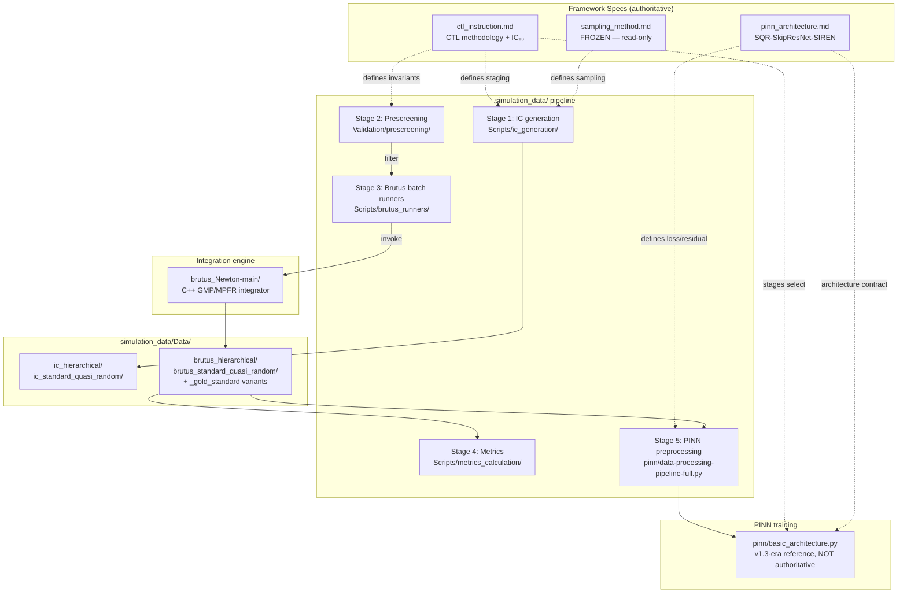

<!-- generated-by: gsd-doc-writer -->
# Architecture

## System overview

This repository implements a complete three-body simulation and CTL-PINN training stack with four loosely coupled subsystems arranged in a data-flow pipeline:

1. **Brutus** (`brutus_Newton-main/`) — a high-precision C++ N-body integrator built on GMP/MPFR arbitrary-precision arithmetic. It is the integration engine that produces ground-truth trajectories.
2. **Python data pipeline** (`simulation_data/`) — IC generation, Stage 2 prescreening, batch runners that drive Brutus, and post-integration metrics calculation. The output is a curated multi-fidelity dataset of three-body trajectories.
3. **Framework specs** (`pinn_instruction/markdown_conversion/framework-specs/`) — the authoritative design documents for the curriculum-training methodology (`ctl_instruction.md`) and the SQR-SkipResNet-SIREN PINN architecture (`pinn_architecture.md`).
4. **PINN training code** (`pinn/`) — the v1.3-era reference implementation that bridges Brutus outputs to ML tensors. Per user directive (2026-05-19) and `pinn-reference.md`, this code is NOT a grounding source for v1.4/v1.5 spec decisions; FUT-01 will rebuild it from the framework specs.

The primary inputs are three-body initial conditions (masses, positions, velocities). The primary outputs are (a) high-precision Brutus trajectory datasets used as PINN training targets, and (b) the locked v1.4 PINN architecture and CTL curriculum that govern how the network is trained.

The architectural style is layered pipeline: Stage 1 IC generation → Stage 2 prescreening → Stage 3 Brutus integration → Stage 4 metrics → Stage 5 PINN preprocessing, with the framework specs acting as the design authority that all stages must conform to.

## Component diagram

## Data flow

A typical request flows top-to-bottom through the pipeline:

1. **IC generation (Stage 1)** — `simulation_data/Scripts/ic_generation/generate_ics.py` writes `.txt` IC files into `simulation_data/Data/ic_hierarchical/` and `ic_standard_quasi_random/`. Two sampling flavors: hierarchical (tight binary + distant tertiary, stable) and standard quasi-random (Sobol-based broad coverage, more chaotic). Sampling is governed by `sampling_method.md` (frozen; historical record only).
2. **Prescreening (Stage 2)** — `simulation_data/Validation/prescreening/stage2_prescreening_revised_auto.py` runs a fast leapfrog integration to filter out colliding/escaping systems before the expensive Brutus pass.
3. **Brutus integration (Stage 3)** — batch runners (`Scripts/brutus_runners/run_brutus_both_type_simple.py`, `run_brutus_hierarchical_only_mac_gold_standard.py`) invoke the compiled `brutus` binary (built from `brutus_Newton-main/` via `make`). Each Brutus run uses arbitrary-precision arithmetic at tolerance `1e-13` or `1e-15` with word lengths 118 or 130 depending on the dataset set. Outputs land in `simulation_data/Data/brutus_<variant>/` and `brutus_<variant>_gold_standard/`. Typical timeout ~3000 s per IC.
4. **Metrics (Stage 4)** — `simulation_data/Scripts/metrics_calculation/calculate_metrics.py` (and `calculate_brutus_metrics.py`) compute energy drift, momentum drift, collision flags, and other quality metrics, writing JSON metric files alongside the Brutus outputs.
5. **PINN preprocessing (Stage 5)** — `pinn/data-processing-pipeline-full.py` consolidates and normalizes Brutus outputs into ML-ready tensors. The v1.4 framework specs define the normalization (`tanh((z − μ_z) / (σ_z + 10⁻⁸))` with dataset-wide statistics) and the input-vector contract (14D = `[τ, IC₁₃]`).

## Key abstractions

### Framework spec contracts (authoritative for v1.4 / v1.5)

| Abstraction | Location | Purpose |
|---|---|---|
| **IC₁₃ vector** (13-dim Jacobi IC) | `pinn_instruction/markdown_conversion/framework-specs/ctl_instruction.md` §5.3 (D-01 LOCKED 2026-05-18) | Input contract: `[m₁, m₂, m₃, ρ_x, λ_x, λ_y, ρ̇_x, ρ̇_y, ρ̇_z, λ̇_x, λ̇_y, λ̇_z, E]`. Replaces the v1.3 IC vector. |
| **Time embedding τ** | Same spec, D-03 LOCKED | `τ = 2u − 1` where `u = t/T` is an autograd leaf. |
| **COM projection head** | `pinn_architecture.md` (D-02 LOCKED 2026-05-18) | Hard mass-weighted center-of-mass projection applied to the 9D output before any loss/metric. |
| **Matched-Plummer softening** | `pinn_architecture.md` (PHYS-03 LOCKED) | Analytic matched-Plummer Hamiltonian `H_ε` evaluates energies from predicted positions and AD-derived velocities; ε_train = 1e-5 (per Phase 28 HC-4 hardening). |
| **Soft conservation regularizers** | `pinn_architecture.md` §1 | Energy and angular-momentum terms penalize drift from initial values. Loss-level constraints, not architecture-level. |
| **SQR-SkipResNet-SIREN backbone** | `pinn_architecture.md` §2 | 12 layers × 256 neurons; SIREN `first_omega_0=30.0`, `hidden_omega_0=1.0` (locked by Phase 20 ARCH-01); Power-Enhanced SkipResNet with `p=2` and LayerNorm on odd layers, `elementwise_affine=False` (locked by Phase 20 ARCH-02). |
| **CTL staging** | `ctl_instruction.md` §"Multi-Stage Data Stratification" | Stages 0 → 1a/1b → 2 → 3 → 4 stratified by total mechanical energy `E`, angular-momentum ratio `L/L_max`, virial ratio `Q = 2T/|V|`, and minimum initial separation `s_min`. |
| **SCS gate** (post-v1.3 convention) | Phase 19 / 28 verdict | Raw Hamiltonian drift `ε_H`; SCS = `log₁₀(ε_H)`; gate: `ε_H > 10⁻⁵` / `SCS > −5`. |
| **Validation contracts (Phase 28)** | `ctl_instruction.md` / `pinn_architecture.md` | SASD (sampling/dataset), IPR (input preprocessing/regularization), PSC (physical-scaling constants). SCS gate above. |

### Dataset shape (v1.5 closure-ready, per STATE.md 2026-06-17)

| Set | IC type | Files | Word length | tolerance | dt_out |
|---|---|---:|---:|---:|---:|
| Set 1a | Hierarchical (original) | 4857 | 130 | 1e-15 | 0.08 |
| Set 1b | Standard (original) | 2749 | 118 | 1e-13 | 0.17 |
| Set 2a | Hierarchical (high-res) | 4857 | 130 | 1e-13 | 0.01 |
| Set 2b | Standard (high-res) | 2565 | 130 | 1e-13 | 0.01 |

Gold-standard completeness state (GAP-29-01 RESOLVED 2026-06-16): **117 validated + 67 permanent gold_counterpart=absent + 0 promoted**. The 184→67 cascade is DEFERRED to FUT-01.

## Directory structure rationale

| Directory | Purpose |
|---|---|
| `brutus_Newton-main/` | Standalone C++ N-body integrator. GMP/MPFR-dependent; built with `make` from the bundled `Makefile`. The integration engine — separate language/runtime because arbitrary-precision arithmetic is the bottleneck. |
| `simulation_data/Scripts/ic_generation/` | Stage 1 — writes IC files to `Data/ic_<variant>/`. Governed by `sampling_method.md` (frozen). |
| `simulation_data/Validation/prescreening/` | Stage 2 — leapfrog-based filter that rejects colliding/escaping systems before the expensive Brutus pass. |
| `simulation_data/Scripts/brutus_runners/` | Stage 3 — Python wrappers that shell out to the compiled `brutus` binary. Includes the FO-1 durability scripts (`rerun_data05_base_hierarchical_70.py`, `rerun_standard_gold_missing_184.py`) and the gold-standard hierarchical runner. |
| `simulation_data/Scripts/metrics_calculation/` | Stage 4 — post-integration quality metrics (energy drift, momentum, collision flags) emitted as JSON metric files. |
| `simulation_data/Data/` | The generated dataset itself (gitignored; restored from backup per migration runbook). Folder name rigidly defines variant — see README §"Dataset Layout and Naming Conventions". |
| `simulation_data/Validation/dataset_readiness_checks/` | Validation scripts. README flags these as Known-Broken (`ValidationConfig` NameError + pattern logic issues); rely on Stage 4 metrics instead. |
| `simulation_data/Documentation/` | Dataset spec, anomalies (`README.md`), blacklist (`problematic_ics_blacklist.json`), and the ID-not-in-gold inventory (`standard_quasi_random_ids_not_in_gold.md`). |
| `pinn/` | v1.3-era PINN reference code (`basic_architecture.py`, `data-processing-pipeline-full.py`). NOT authoritative for v1.4/v1.5; rebuilt from specs in FUT-01. |
| `pinn_instruction/markdown_conversion/framework-specs/` | Authoritative framework specs: `ctl_instruction.md`, `pinn_architecture.md`, `sampling_method.md` (frozen). |
| `pinn_instruction/markdown_conversion/framework-revisions/` | Research reports and resolution-doc materials. `data_quality_assessment.md` is read-only (SCOPE-09). |
| `pinn_instruction/markdown_conversion/framework-specs/integrity-r1/` | Integrity-r1 package (Phase 26 — pass-through consistency check artifacts). |
| `pinn_instruction/markdown_conversion/framework-specs/trainex-r1/` | Training-execution research package (trainex track, round 1). |
| `reference-code/` | Reference implementations of N-body integrators, Lyapunov analysis, and other baselines used during framework development. |
| `tools/spec-render-check/` | Framework-spec render detector suite (added in v1.4 Phase 22). Catches rendering regressions in the markdown specs. |
| `paper_templates/` | LaTeX/typst templates for documentation or papers. |
| `docs/runbooks/` | Operational procedures (migration, external research, EDL). |
| `docs/work/plans/`, `docs/work/reviews/`, `docs/work/designs/` | Lifecycle-managed GSD work artifacts (see `docs/README.md`). |
| `.planning/` | GSD planning artifacts: `REQUIREMENTS.md`, `ROADMAP.md`, `STATE.md`, milestone-specific phases, gap registers. |
| `.planning/research/edl/` | Non-canonical Empirical Decision Loop research-support briefs for source-silent gaps. |
| `.claude/rules/` | Path-scoped Claude Code rules (`repo-map.md`, `pinn-reference.md`, `docs-conventions.md`, etc.). |
| `scripts/` | Repo-local scripts (e.g., `agent-commit`, `setup-git-hooks.sh`) used by the agent workflow. |
| `tests/` | Repository-level tests for tooling (e.g., phase 12 validation). The FO-1 durability test for the gold-missing rerun lives at `simulation_data/Scripts/brutus_runners/`. |

## Notes on governance and grounding

- **STOP protocol active**: source-silent semantic / process-schema / cross-phase decisions are surfaced as gaps, never invented. Phase-local `NN-GAPS.md` files plus the milestone-wide index at `.planning/milestones/v1.5-GAPS.md` are authoritative.
- **`pinn/` live-code ban**: code under `pinn/` is NOT a grounding source for v1.5 spec decisions; forward-pointing hand-off documents (`NN-CODE-DIVERGENCE.md`, eventual `pinn/STATUS.md`) are the only permitted references.
- **`sampling_method.md` is FROZEN** (SCOPE-08): read-only as the historical record of how the existing dataset was produced.
- **`data_quality_assessment.md` is read-only** (SCOPE-09): a research report, not an authoritative spec.
- **Spec-edit targets**: `ctl_instruction.md` and `pinn_architecture.md` ONLY.
- **Current milestone state**: v1.5 (Phases 23–29) is closure-ready as of 2026-06-17; the `milestone/v1.5` → `master` `--no-ff` merge is user-owned. FUT-01 then consumes the two-artifact handoff (`29-HANDOFF.md` + `29-CODE-DIVERGENCE.md`).
