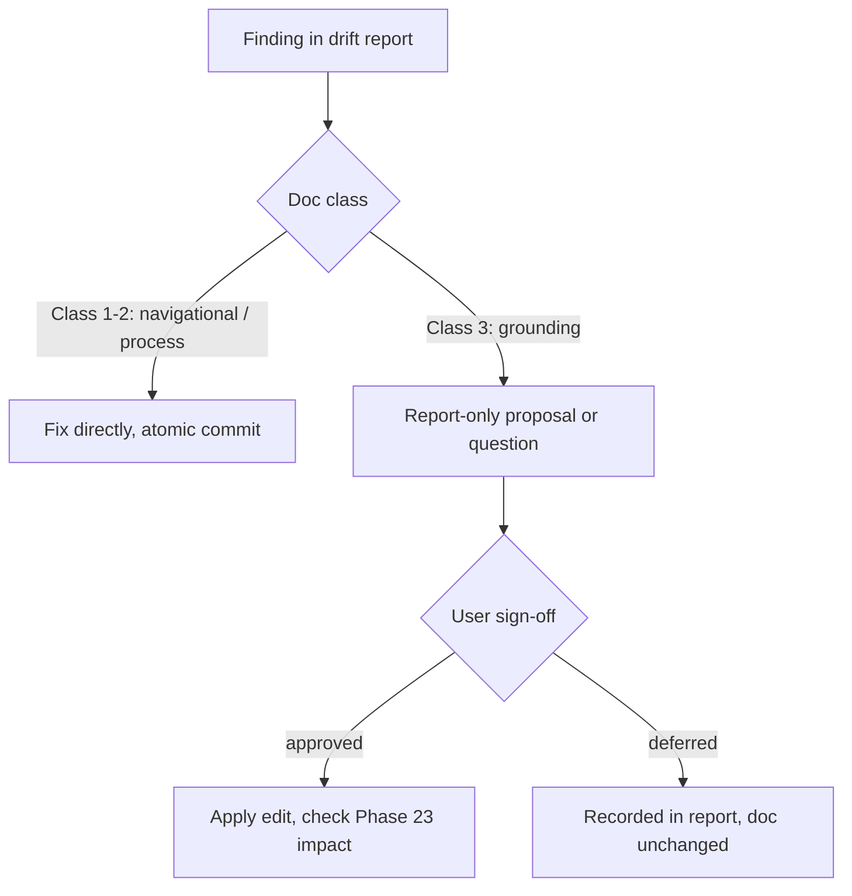

# Documentation Integrity Audit — Requirements

## Summary

A routine integrity check of the project-owned documentation: layered verification of 13 docs across three classes, producing a dated drift report. Navigational and process docs are fixed directly; grounding-class docs are report-only with per-edit user sign-off. A committed runbook makes the check repeatable at every milestone boundary.

---

## Problem Frame

This is preventive hygiene — no drift has been observed. The motivation is positional: v1.4 (Phases 17–22) reshaped the framework-spec landscape, and v1.5 (Phases 23–29) is now running adjudication that reads designated grounding sources. Documentation drift has two distinct cost shapes here. Docs loaded into every agent session (root entry docs, `.claude/rules/`) mislead all future work if stale. Grounding-class docs feed adjudication directly — a stale claim there can propagate into spec verdicts, and Phase 23 is assembling its research package from those sources right now.

The dataset spec source of truth, `simulation_data/Documentation/README.md`, was last committed 2026-05-02 — before all of v1.4 completed. The dataset it describes is frozen, which lowers drift risk for that file but leaves it unverified; the docs describing *moving* things (repo navigation, process rules, the spec landscape) are the more likely drift sites.

---

## Key Decisions

- **Two-class treatment of findings.** Navigational/process docs (Classes 1–2) are fixed directly; grounding-class docs (Class 3) are report-only with per-finding user sign-off. Rationale: v1.5 runs under a STOP protocol in which grounding sources must not be silently edited mid-adjudication; the gate protects the evidence base at the cost of audit speed.
- **Audit-first, not update-first.** A drift report precedes any edit. Driving the check through an update-oriented tool (e.g., `gsd-docs-update`) was rejected because it wants to write docs, which conflicts with the gate on Class 3.
- **Run now, in parallel with Phase 23.** Grounding-doc findings surfacing while the research package is mid-assembly is the point, not a conflict — stale claims get caught before the package ships to external research.
- **Sampling-depth verification for the dataset README.** Claims are spot re-derived against the on-disk data, not exhaustively re-validated across 11k+ simulation runs. The dataset is frozen, so exhaustive re-validation is disproportionate to risk.
- **Runbook makes "routine" actual.** The audit procedure, inventory, and — importantly — the fixable-vs-gated classification of every doc become a committed artifact. Today that classification exists only in conversation; making it durable has governance value beyond this audit.

---

## Audit Inventory

Snapshot as of 2026-06-10. `CLAUDE.md` and `GEMINI.md` are symlinks to `AGENTS.md` (verified), so 15 paths resolve to 13 real files.

| Doc | Class | Treatment | Last commit |
|---|---|---|---|
| `README.md` | 1 — root entry | direct fix | 2026-06-08 |
| `AGENTS.md` (targets of `CLAUDE.md`, `GEMINI.md` symlinks) | 1 — root entry | direct fix | 2026-06-10 |
| `ANTIGRAVITY.md` | 1 — root entry | direct fix | 2026-06-07 |
| `.claude/rules/repo-map.md` | 1 — agent rules | direct fix | 2026-05-24 |
| `.claude/rules/dataset-reference.md` | 1 — agent rules | direct fix | 2026-05-19 |
| `.claude/rules/pinn-reference.md` | 1 — agent rules | direct fix | 2026-06-09 |
| `docs/README.md` | 2 — process | direct fix | 2026-06-09 |
| `docs/git-guidelines.md` | 2 — process | direct fix | 2026-06-07 |
| `pinn_instruction/issues/README.md` | 2 — sub-area | direct fix | 2026-05-12 |
| `pinn_instruction/markdown_conversion/README.md` | 2 — sub-area | direct fix | 2026-05-20 |
| `tools/spec-render-check/README.md` | 2 — sub-area | direct fix | 2026-06-09 |
| `simulation_data/Documentation/README.md` | 3 — grounding | report-only, gated | 2026-05-02 |
| `simulation_data/Data/testing_data/README_TESTING.md` | 3 — grounding | report-only, gated | 2026-03-20 |

---

## Requirements

**Coverage**

- R1. Every doc in the audit inventory receives a per-doc verdict in the drift report: verified-current, drift-found (with itemized findings), or not-verifiable (with reason).
- R2. Excluded surfaces are never edited by the audit: `.planning/` docs, the framework specs and issue docs, `sampling_method.md` (frozen), `data_quality_assessment.md` (read-only), and vendored third-party READMEs. The audit may read them to cross-check claims in in-scope docs.

**Verification method**

- R3. Mechanical checks on every in-scope doc: referenced paths, scripts, and files exist; internal cross-references resolve.
- R4. Targeted drift detection on Classes 1–2: repo changes since each doc's last commit are reviewed for changes that should have updated the doc.
- R5. Deep content verification on Class 3: claims spot-verified against the on-disk `simulation_data/` tree and `simulation_data/Scripts/`; sampled rather than exhaustive, with each check recorded re-derivably (claim, method, result).
- R6. Agent-entry consistency: `AGENTS.md` and `ANTIGRAVITY.md` must not contradict each other, and the `CLAUDE.md` / `GEMINI.md` symlinks must be intact.

**Drift handling**

- R7. Class 1–2 drift is fixed directly; every fix traces to a report finding and is committed per the repo commit protocol.
- R8. Class 3 findings are report-only: no edit to a grounding doc without explicit user sign-off on that finding.
- R9. Proposed Class 3 edits must be grounded in direct observation of on-disk data. Where correct content cannot be established by observation, the finding is surfaced as a question to the user — content is never invented.
- R10. Findings that could affect v1.5 adjudication inputs are flagged to the user before Phase 23's research package is finalized. Coordination gate: Class 3 verification completes before Phase 23 finalizes the research package; if the audit cannot meet this deadline, the user is notified to hold finalization until the flag is resolved.

**Runbook**

- R11. A committed runbook under `docs/runbooks/` captures the doc inventory, each doc's class and treatment, per-doc verification criteria, and the re-run procedure for future milestone boundaries.
- R12. The runbook is checklist-shaped — criteria and pointers only, never duplicated doc content — so it does not itself become a drift surface.

**Process integration**

- R13. The drift report is a dated, committed artifact following the docs lifecycle conventions in `docs/README.md`, with the report commit separate from any fix commits.

---

## Key Flows

- F1. Audit pass
  - **Trigger:** Milestone-boundary integrity check (this run: 2026-06-10).
  - **Guard:** Excluded surfaces (per R2) are never touched.
  - **Steps:** Snapshot inventory; run mechanical checks; run class-scaled content verification; compose dated drift report; produce committed runbook under `docs/runbooks/`; user reviews report.
  - **Outcome:** Per-doc verdicts, a direct-fix queue (Classes 1–2) separated from gated proposals (Class 3), and a committed runbook capturing the inventory, class assignments, and verification criteria.
  - **Covers:** R1, R2, R3–R6, R11, R12, R13.
- F2. Direct fix pass
  - **Trigger:** Report reviewed; Class 1–2 findings exist.
  - **Steps:** Apply each fix; commit atomically with reference to the finding.
  - **Covers:** R7, R13.
- F3. Grounding gate
  - **Trigger:** A Class 3 finding.
  - **Steps:** Present evidence-based proposed edit (or question, when observation cannot settle it); user signs off or defers; on approval, apply the edit and check whether Phase 23 already consumed the stale claim.
  - **Covers:** R8–R10.

---

## Acceptance Examples

- AE1. **Covers R4, R7.** Given a Class 1 doc that names a script which has since moved, when the audit runs, then the report records the finding and the path is corrected in a commit traceable to that finding.
- AE2. **Covers R5, R8.** Given a dataset README claim contradicted by the on-disk data, when the audit runs, then the report records the finding with evidence and the README remains byte-identical until the user signs off.
- AE3. **Covers R5, R9.** Given a dataset README claim that cannot be verified by observation (e.g., it would require re-running simulations), then the claim is recorded as not-verifiable and surfaced as a question — no replacement content is proposed.
- AE4. **Covers R10.** Given any grounding-doc finding while Phase 23's research package is not yet finalized, then the user is flagged before finalization.
- AE5. **Covers R1.** Given a doc where every check passes, then the report still records a verified-current verdict listing the checks performed.

---

## Success Criteria

- Every inventory doc has a verdict; no doc is marked verified-current without recorded checks behind it.
- Grounding docs are byte-identical at audit end unless a signed-off edit exists for each change.
- Zero contradictions between `AGENTS.md` and `ANTIGRAVITY.md` after the fix pass.
- The next milestone-boundary check can be run from the runbook alone, with no redesign.

---

## Scope Boundaries

- `.planning/` docs (PROJECT.md, ROADMAP.md, phase artifacts, EDL briefs) — maintained by the GSD workflow; auditing them duplicates `gsd-health` and risks colliding with live Phase 23 state.
- Framework specs (`ctl_instruction.md`, `pinn_architecture.md`) and issue docs — content is governed by the v1.4/v1.5 adjudication lifecycle, not by this audit.
- `sampling_method.md` (frozen by default) and `data_quality_assessment.md` (read-only) — explicitly not audit edit targets under any finding.
- Vendored third-party READMEs (`brutus_Newton-main/`, `reference-code/` including the PyTorch tree) — not project-owned content.
- `pinn/` live code — not a grounding source and not a documentation surface for this audit.
- Automation of the checks is not required; whether any mechanical check gets a small script is a planning decision, not a requirement.

---

## Dependencies / Assumptions

- `simulation_data/` is frozen — no concurrent changes during the audit (user-confirmed 2026-06-10).
- Phase 23 (research package assembly) is in progress on `milestone/v1.5`; the audit runs in parallel, with R10's coordination gate as the sequencing mechanism: Class 3 verification must complete before Phase 23 finalizes the research package.
- `CLAUDE.md` and `GEMINI.md` are symlinks to `AGENTS.md` (verified 2026-06-10); consistency checks target the two real files.
- The inventory is a point-in-time snapshot; docs created later are picked up at the next runbook re-run.
- Report and commit mechanics follow `docs/README.md` (artifact lifecycle) and `docs/git-guidelines.md` (commit protocol).

---

## Outstanding Questions

**Deferred to Planning**

- Whether the mechanical checks (R3) warrant a small committed script (precedent: `tools/spec-render-check/`) or remain manual checklist steps in the runbook.
- Drift report filename and location per `docs/README.md` conventions.
- Which branch carries the audit commits (presumably `milestone/v1.5`, where the work is happening).

---

## Sources

- Doc inventory and last-commit dates gathered 2026-06-10 (table above).
- Governance constraints: `CLAUDE.md` (STOP protocol and v1.5 applicability; frozen/read-only status of `sampling_method.md` and `data_quality_assessment.md`), `.planning/REQUIREMENTS.md` SCOPE-06–SCOPE-09.
- Artifact and commit conventions: `docs/README.md`, `docs/git-guidelines.md`.
