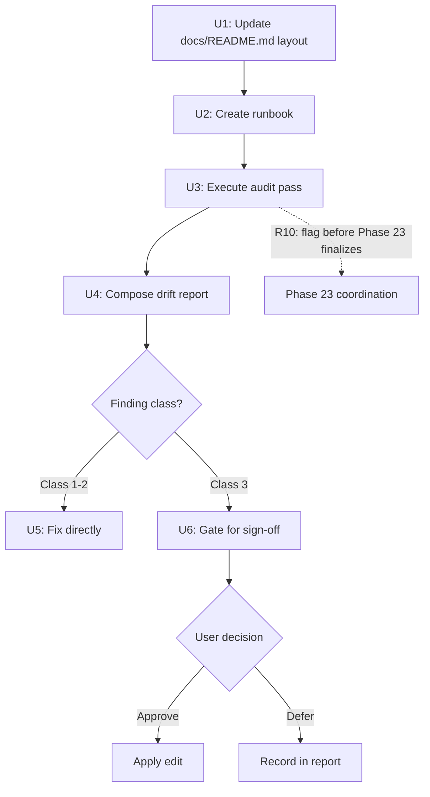

# Documentation Integrity Audit Plan

## Summary

Layered integrity verification of 13 project-owned docs across three treatment classes, producing a dated drift report, direct fixes for navigational/process docs, gated proposals for grounding-class docs, and a committed runbook for repeatable milestone-boundary checks. Runs in parallel with Phase 23 on `milestone/v1.5`.

## Problem Frame

v1.4 (Phases 17–22) reshaped the framework-spec landscape and triggered a mid-May repo reorganization that moved and renamed several docs. v1.5 (Phases 23–29) is now running adjudication that reads designated grounding sources. Documentation drift has two distinct cost shapes here. Docs loaded into every agent session (root entry docs, `.claude/rules/`) mislead all future work if stale. Grounding-class docs feed adjudication directly — a stale claim there can propagate into spec verdicts, and Phase 23 is assembling its research package from those sources right now.

This is preventive hygiene — no drift has been observed. The dataset spec source of truth (`simulation_data/Documentation/README.md`) was last committed 2026-05-02, before v1.4 completed. The dataset it describes is frozen, which lowers drift risk but leaves it unverified. The docs describing moving things (repo navigation, process rules, the spec landscape) are the more likely drift sites, particularly the four oldest: `.claude/rules/dataset-reference.md` (22 days), `pinn_instruction/issues/README.md` (~1 month), `simulation_data/Documentation/README.md` (~6 weeks), and `simulation_data/Data/testing_data/README_TESTING.md` (~3 months).

---

## Requirements

**Coverage**

- R1. Every doc in the audit inventory receives a per-doc verdict in the drift report: verified-current, drift-found (with itemized findings), or not-verifiable (with reason).
- R2. Excluded surfaces are never edited by the audit: `.planning/` docs, framework specs, issue docs, `sampling_method.md` (frozen), `data_quality_assessment.md` (read-only), and vendored third-party READMEs. The audit may read them to cross-check claims in in-scope docs.

**Verification method**

- R3. Mechanical checks on every in-scope doc: referenced paths, scripts, and files exist; internal cross-references resolve.
- R4. Targeted drift detection on Classes 1–2: repo changes since each doc's last commit are reviewed for changes that should have updated the doc.
- R5. Deep content verification on Class 3: claims spot-verified against the on-disk `simulation_data/` tree and `simulation_data/Scripts/`; sampled rather than exhaustive, with each check recorded re-derivably (claim, method, result).
- R6. Agent-entry consistency: `AGENTS.md` and `ANTIGRAVITY.md` must not contradict each other; `CLAUDE.md` / `GEMINI.md` symlinks must be intact.

**Drift handling**

- R7. Class 1–2 drift is fixed directly; every fix traces to a report finding and is committed per the repo commit protocol.
- R8. Class 3 findings are report-only: no edit to a grounding doc without explicit user sign-off on that finding.
- R9. Proposed Class 3 edits must be grounded in direct observation of on-disk data. Where correct content cannot be established by observation, the finding is surfaced as a question — content is never invented.
- R10. Findings that could affect v1.5 adjudication inputs are flagged to the user before Phase 23's research package is finalized.

**Runbook**

- R11. A committed runbook under `docs/runbooks/` captures the doc inventory, each doc's class and treatment, per-doc verification criteria, and the re-run procedure for future milestone boundaries.
- R12. The runbook is checklist-shaped — criteria and pointers only, never duplicated doc content — so it does not itself become a drift surface.

**Process integration**

- R13. The drift report is a dated, committed artifact following the docs lifecycle conventions in `docs/README.md`, with the report commit separate from any fix commits.

---

## Key Technical Decisions

KTD1. **Manual checklist over committed script for mechanical checks.** `tools/spec-render-check/` is continuous regression testing with a committed Node.js script (847 lines, pinned deps). This audit is milestone-triggered, judgment-heavy, and one-time per boundary. The mechanical checks are path existence and cross-reference resolution — better served as checklist items in the runbook. A committed script is disproportionate to scope; automation is a future enhancement, not a current requirement.

KTD2. **Cross-cutting artifact placement.** The audit spans the full repo doc surface, not a single GSD phase. Per `docs/README.md`, cross-cutting work goes in `docs/work/{plans,reviews}/cross_cutting/<topic>/`. This avoids collision with Phase 23's milestone-scoped artifacts and keeps the audit self-contained.

KTD3. **Drift report as a review artifact.** The drift report contains findings (per-doc verdicts, itemized drift, evidence). Per `docs/README.md`, finding-bearing documents belong in `docs/work/reviews/`, not `docs/work/plans/`. This triggers the stricter lifecycle: finding-by-finding closeout before any future deletion proposal.

KTD4. **Branch: `milestone/v1.5`.** The audit runs in parallel with Phase 23 on the same branch. Commits use the `docs` type with appropriate scopes. The coordination gate (R10) ensures Class 3 findings surface before Phase 23 finalizes.

KTD5. **Audit execution is read-only until the report is committed.** The mechanical checks, drift detection, and content verification (U3) produce findings, not file edits. The drift report (U4) must be a complete record before any fixes are applied (U5, U6). This separation ensures the report is audit-grade evidence of the repo state at the time of the check.

---

## High-Level Technical Design

The audit follows a prepare → verify → remediate flow. The branching gate separates direct-fix findings (Classes 1–2) from gated proposals (Class 3), with a coordination back-channel to Phase 23.

---

## Implementation Units

### U1. Update docs/README.md directory layout

**Goal:** Add the `docs/runbooks/maintenance/` subfolder to the directory layout tree in `docs/README.md` so the structure documentation is accurate before the runbook is created there.

**Requirements:** R11

**Dependencies:** none

**Files:** `docs/README.md`

**Approach:** Add `maintenance/` to the "Preferred structure for new docs" code block, next to the existing `migration/` entry. The subfolder is already mentioned in the runbooks prose examples but absent from the visual tree. Also add `EDL/` which already exists on disk but is missing from the layout. These are layout-accuracy fixes only — no prose changes needed.

**Patterns to follow:** The existing layout conventions and visual tree format in `docs/README.md`.

**Test expectation:** none — layout tree update, no behavioral change.

**Verification:** The visual tree in `docs/README.md` matches the actual `docs/runbooks/` directory structure on disk.

---

### U2. Create the audit runbook

**Goal:** Produce the committed checklist-shaped runbook at `docs/runbooks/maintenance/doc-integrity-audit-runbook.md`, capturing the full doc inventory, class assignments, per-doc verification criteria, and re-run procedure.

**Requirements:** R11, R12

**Dependencies:** U1

**Files:** `docs/runbooks/maintenance/doc-integrity-audit-runbook.md`

**Approach:** The runbook contains: (1) the full doc inventory table — doc path, class, treatment, last-verified date; (2) per-doc verification criteria — which checks apply by class; (3) the re-run procedure — step-by-step for each check type. Checklist format throughout — criteria and pointers only, never duplicated doc content. Frontmatter: `status: active`, `purpose: runbook`, `created: 2026-06-10`, `milestone: v1.5`. The inventory snapshot is the table from the origin requirements doc, with a `last_verified` column added and initially blank.

**Patterns to follow:** `docs/runbooks/migration/exact-state-mac-migration.md` (existing runbook structure and frontmatter pattern).

**Test expectation:** none — operational runbook, no behavioral change.

**Verification:** The runbook lists all 13 audit docs with correct class assignments and treatment labels; every R-ID is addressed by at least one checklist item; the re-run procedure is self-contained.

---

### U3. Execute full audit pass

**Goal:** Run all verification checks on all 13 docs and produce a structured findings list feeding the drift report.

**Requirements:** R2, R3, R4, R5, R6

**Dependencies:** U2 (runbook provides the checklist)

**Files:** All 13 audit docs (read-only during this step); `simulation_data/` tree and `simulation_data/Scripts/` for Class 3 verification

**Approach:** Three check tracks run per doc, scaled by class:

**Track 1 — Mechanical checks (R3, all 13 docs):** For each doc, extract all referenced paths, files, and scripts. Verify each exists on disk (`test -f`, `ls`). Resolve internal markdown cross-references. Record broken references.

**Track 2 — Drift detection (R4, 9 Class 1–2 docs):** For each Class 1–2 doc, run `git log --oneline -- <doc-path>` to get the last-touch commit, then `git log <last-touch-commit>..HEAD --stat` to see what changed since. Review each commit's diff for changes that affect the doc's content: moved paths, new/removed scripts, structural changes, new directories, renamed files.

**Track 3 — Content verification (R5, 2 Class 3 docs):** For each Class 3 doc, enumerate factual claims about the dataset. Spot-verify each against on-disk data: directory listings, file counts, column names in CSV headers, script argument signatures. Record: claim, verification method, result (verified / contradicted with evidence / not-verifiable with reason). Sampling-based, not exhaustive — the dataset is frozen and exhaustive re-validation is disproportionate to risk.

**Agent-entry consistency (R6):** Read `AGENTS.md` and `ANTIGRAVITY.md` side by side. Flag any point where they give contradictory guidance. Verify `CLAUDE.md` and `GEMINI.md` remain symlinks to `AGENTS.md` (`ls -la`).

**Guard (R2):** Excluded surfaces (`.planning/`, framework specs, issue docs, frozen/read-only files, vendored READMEs, `pinn/` live code) may be read for cross-checking but are never edited.

**Patterns to follow:** The re-derivable recording pattern from Phase 22 content integrity audits (claim, method, result per check).

**Test scenarios:**
- A doc with all references intact and no drift → verified-current verdict with checks listed. Covers AE5.
- A doc referencing a moved path → finding recorded with evidence (old path, actual location). Covers AE1 (finding side).
- A Class 3 claim contradicted by on-disk data → finding with evidence, no edit applied. Covers AE2.
- A Class 3 claim requiring simulation re-runs to verify → not-verifiable, surfaced as question. Covers AE3.
- `AGENTS.md` and `ANTIGRAVITY.md` disagree on a convention → finding recorded.

**Verification:** Every doc in the inventory has at least one recorded check; no doc is marked verified-current without evidence behind it; all Class 3 checks are recorded re-derivably.

---

### U4. Compose and commit the drift report

**Goal:** Produce the dated drift report with per-doc verdicts and commit it as a review artifact.

**Requirements:** R1, R13

**Dependencies:** U3

**Files:** `docs/work/reviews/cross_cutting/doc-integrity-audit/2026-06-10-doc-integrity-audit-drift-report.md`

**Approach:** For each of the 13 docs, compose a verdict section: (1) doc path, (2) class, (3) verdict (verified-current / drift-found / not-verifiable), (4) itemized checks performed, (5) itemized findings with evidence. The report structure follows `docs/README.md` review conventions. Frontmatter: `status: active`, `purpose: review-findings`, `created: 2026-06-10`, `milestone: v1.5`.

Commit per `docs/git-guidelines.md`: `docs(cross_cutting): commit doc integrity audit drift report` with a body summarizing verdict counts (N verified-current, M drift-found, K not-verifiable) and scope. The report commit is separate from any fix commits (R13).

**Patterns to follow:** Review report format from existing reviews in `docs/work/reviews/milestone_v1.4/`.

**Test scenarios:**
- Each Class 1–2 finding includes a traceable ID for U5 to reference. Covers AE1 (report-to-fix traceability).
- A doc where all checks pass still lists the checks performed. Covers AE5.

**Verification:** All 13 docs have verdicts; no doc is marked verified-current without recorded checks; the report is committed separately from any fix commits.

---

### U5. Fix Class 1–2 drift findings

**Goal:** Apply direct fixes for navigational and process doc drift identified in the report.

**Requirements:** R7

**Dependencies:** U4 (drift report must exist with findings)

**Files:** Whatever Class 1–2 docs have findings (determined by U3/U4)

**Approach:** For each Class 1–2 finding in the drift report, apply the fix. Each fix traces to a report finding by ID. Commit atomically: one commit per finding or logical group of closely related findings (e.g., multiple broken paths in the same doc). Commit messages reference the finding ID and follow the repo protocol: `docs(<scope>): <description>` with body. If a finding reveals that a doc needs substantial rewriting (not just a path correction), flag it for user review rather than rewriting unilaterally.

**Patterns to follow:** The commit separation discipline from `docs/git-guidelines.md` — findings and fixes in separate commits; findings commit precedes fixes.

**Test scenarios:**
- A broken path reference is corrected → post-fix mechanical check confirms the reference resolves.
- Multiple related broken references in the same doc → single commit fixing all, each finding referenced in the body.

**Verification:** Post-fix mechanical check (re-run the relevant checks from U3 for fixed docs) confirms all fixed findings now pass. No new regressions introduced by fixes.

---

### U6. Gate Class 3 findings for user sign-off

**Goal:** Surface grounding-doc findings with evidence-based proposed edits or questions; enforce the Phase 23 coordination gate.

**Requirements:** R8, R9, R10

**Dependencies:** U4 (drift report must exist)

**Files:** `simulation_data/Documentation/README.md`, `simulation_data/Data/testing_data/README_TESTING.md` (unchanged until sign-off)

**Approach:** Present each Class 3 finding to the user:

- Where observation settles the correct content (R9): propose a specific edit with evidence (e.g., "claim says 11,000 runs; on-disk count is 11,247; proposed edit: update to 11,247").
- Where observation cannot settle it (R9): surface as a question with the conflicting evidence (e.g., "claim describes a filtering step not visible in the scripts; cannot verify by observation").
- On user approval: apply the edit in a separate commit referencing the finding ID.
- On user deferral: record the deferral in the drift report's finding status.
- Coordination gate (R10): before Phase 23 finalizes its research package, flag any Class 3 finding that could affect adjudication inputs. If the audit cannot meet the Phase 23 deadline, notify the user to hold finalization until the flag is resolved.

**Patterns to follow:** The STOP protocol gating pattern from `CLAUDE.md` — grounding sources are not silently edited mid-adjudication. Each proposed edit is grounded in direct observation, never invented.

**Test scenarios:**
- A Class 3 claim contradicted by on-disk data → proposed edit with evidence; doc remains byte-identical until user approves. Covers AE2.
- A Class 3 claim unverifiable by observation → surfaced as question, no replacement content proposed. Covers AE3.
- Any grounding finding while Phase 23 is not yet finalized → user flagged before finalization. Covers AE4.

**Verification:** Every Class 3 finding is presented to the user; no edit is applied without explicit sign-off; Phase 23 coordination gate is checked and documented.

---

## Acceptance Examples

- AE1. Given a Class 1 doc that names a script which has since moved, when the audit runs, then the report records the finding and the path is corrected in a commit traceable to that finding. (Covers R4, R7.)
- AE2. Given a dataset README claim contradicted by the on-disk data, when the audit runs, then the report records the finding with evidence and the README remains byte-identical until the user signs off. (Covers R5, R8.)
- AE3. Given a dataset README claim that cannot be verified by observation, then the claim is recorded as not-verifiable and surfaced as a question — no replacement content is proposed. (Covers R5, R9.)
- AE4. Given any grounding-doc finding while Phase 23's research package is not yet finalized, then the user is flagged before finalization. (Covers R10.)
- AE5. Given a doc where every check passes, then the report still records a verified-current verdict listing the checks performed. (Covers R1.)

---

## Scope Boundaries

Excluded surfaces are never edited by the audit:

- `.planning/` docs (PROJECT.md, ROADMAP.md, phase artifacts, EDL briefs) — maintained by GSD; auditing duplicates `gsd-health` and risks colliding with live Phase 23 state.
- Framework specs (`ctl_instruction.md`, `pinn_architecture.md`) and issue docs — governed by the v1.4/v1.5 adjudication lifecycle.
- `sampling_method.md` (frozen by default) and `data_quality_assessment.md` (read-only) — explicitly not audit edit targets.
- Vendored third-party READMEs (`brutus_Newton-main/`, `reference-code/`) — not project-owned content.
- `pinn/` live code — not a grounding source and not a documentation surface.

### Deferred to Follow-Up Work

- Automation of mechanical checks into a committed script (future enhancement if the audit repeats frequently and the manual checklist proves burdensome).
- Organizational decision on `docs/brainstorms/` directory placement — currently untracked and not documented in `docs/README.md`; conventions point to `docs/work/designs/` but ce-brainstorm creates files there by default.

---

## Risks & Dependencies

- **Phase 23 parallel execution.** The audit runs on `milestone/v1.5` while Phase 23 assembles its research package. The coordination gate (R10) is the sequencing mechanism. Risk: if Class 3 verification is slow, it could delay Phase 23 finalization. Mitigation: Class 3 verification is bounded (2 docs, sampling-based).
- **Dataset frozen assumption.** The audit assumes `simulation_data/` is not changing during execution (user-confirmed 2026-06-10). If this changes, Class 3 verification results may be invalidated.
- **Point-in-time snapshot.** The report captures the repo state at audit time. Docs created or modified after the audit are not covered until the next runbook re-run.
- **Origin doc is untracked.** The brainstorm requirements doc at `docs/brainstorms/2026-06-10-doc-integrity-audit-requirements.md` is currently untracked. It should be committed before audit execution begins so the `origin:` reference in this plan resolves reliably.

---

## Sources & Research

- Origin requirements: `docs/brainstorms/2026-06-10-doc-integrity-audit-requirements.md`
- Docs conventions: `docs/README.md`
- Commit protocol: `docs/git-guidelines.md`
- Verification tooling precedent: `tools/spec-render-check/` (directory structure, README format, pinned deps)
- Past content integrity work: Phase 22 content-audit tooling and re-derivable recording pattern
- Governance surface propagation: `docs/work/designs/cross_cutting/git-guidelines/2026-06-07-docs-lifecycle-git-behavior-design.md`
- Docs reorganization findings: `docs/work/designs/plans/cross_cutting/docs-folder-reorganization/`
