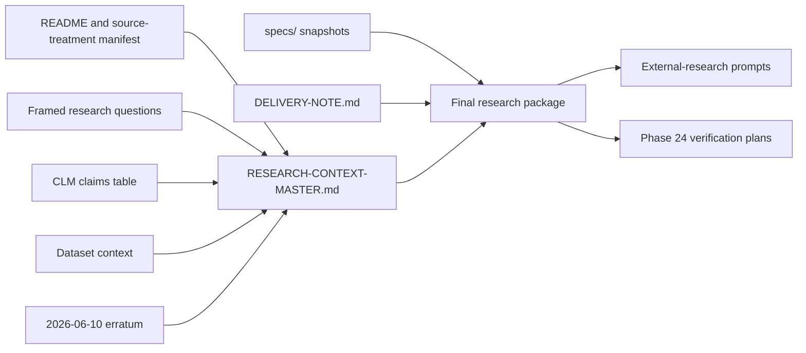

# Refactor: Consolidate the Issue-02 Research Context

## Summary

Replace the five top-level research-context files in the issue-02 research package with one
`RESEARCH-CONTEXT-MASTER.md` while keeping `DELIVERY-NOTE.md` standalone and leaving every file
under `specs/` byte-for-byte unchanged.

This is a Phase 23 post-delivery remediation, not a formal phase reopen or a new adjudication pass.
The work also performs a grounded accuracy sweep, folds the existing erratum into the corrected
master text, updates active consumers to the new package layout, and rebaselines Phase 24 without
changing its empirical-verification scope.

## Origin And Scope

**Origin:** User instruction dated 2026-06-11.

**Package root:** `pinn_instruction/markdown_conversion/framework-revisions/research_reports/02-data-pipeline-and-validation/research_package/`.
Paths beginning with `research_package/` below are shorthand beneath this repo-relative root.

**In scope:**

- Consolidate these five files:
  - `research_package/README.md`
  - `research_package/framed-research-questions.md`
  - `research_package/claims-table.md`
  - `research_package/consolidated-context.md`
  - `research_package/ERRATUM-2026-06-10.md`
- Create `research_package/RESEARCH-CONTEXT-MASTER.md`.
- Keep `research_package/DELIVERY-NOTE.md` as a separate file and update only its package-layout
  references.
- Keep all five `research_package/specs/*.md` snapshots intact.
- Update active Phase 23 handoff records, external-research prompts, and Phase 24 plans that consume
  the old file layout.
- Re-run package-level factual, provenance, coverage, and reference checks.

**Out of scope:**

- Replanning or re-executing the original five Phase 23 plans.
- Editing any file under `research_package/specs/`.
- Editing canonical framework specs or `data_quality_assessment.md`.
- Completing Phase 24 DATA-01..07 probes or promoting `claimed-unverified` rows to `verified`.
- Resolving issue-02 semantic questions, CLM schema questions, or Phases 25-29 adjudication.
- Using `pinn/` live code as evidence.

## Requirements

- **R1 - One context file:** The package has one top-level research-context master after
  consolidation, alongside the standalone delivery note and `specs/`.
- **R2 - Complete coverage:** Every substantive section from the five source files is either present
  in the master or explicitly superseded by a grounded correction.
- **R3 - Corrected facts:** The master presents the known filename and missing-footer facts correctly,
  without requiring the reader to reconcile stale text against a separate erratum.
- **R4 - Status integrity:** Existing CLM IDs and verification statuses remain intact unless Phase 24
  later changes them through its approved correction channel.
- **R5 - Spec immutability:** Every `specs/*.md` file remains byte-identical to the pre-remediation
  baseline.
- **R6 - Consumer continuity:** The delivery note, research prompts, and active Phase 24 documents
  point to the master and its named sections rather than deleted files.
- **R7 - Historical clarity:** Phase 23 remains completed, with the consolidation recorded as a
  post-delivery remediation and its verification evidence committed in existing Phase 23 records.
- **R8 - Re-derivable verification:** Counts, hashes, heading coverage, and reference-sweep results
  used to declare success are recorded in committed state.

---

## Preliminary Accuracy Findings

The planning pass found the following grounded facts that implementation must preserve:

- A read-only full-folder scan on 2026-06-11 reconfirmed 4,857 hierarchical, 4,857 hierarchical
  gold, 2,749 standard, and 2,565 standard-gold Brutus output files.
- The same scan found zero `_gold_` filename infixes in both gold output folders.
- `Result:` presence was 3,307/4,857, 4,857/4,857, 2,048/2,749, and 2,346/2,565 respectively,
  confirming missing-footer populations of 1,550, 0, 701, and 219.
- The blacklist contains 2 hierarchical and 63 standard IDs, total 65.
- The standard base-minus-gold ID set contains 184 IDs.
- `ERRATUM-2026-06-10.md` correctly identifies the stale filename and footer narratives still
  present in `consolidated-context.md`, including CLM-07's incorrect "minimal footer"
  characterization.
- Phase 24 has plans but no execution summaries or verified-facts register yet. All other empirical
  claims therefore retain their current Phase 23 status.
- Phase 23 review items WR-01 through WR-04 remain relevant. The master may report their conflicts
  accurately, but must not invent the pending CLM-row/schema decisions owned by the Phase 24 user
  gate.

These checks are planning evidence, not a substitute for Phase 24's committed, re-derivable probes.

---

## High-Level Design

The master preserves the original research flow:

1. Package orientation, source treatment, and file manifest.
2. Framed research questions and locked constraints.
3. CLM claims register.
4. Consolidated dataset evidence and source excerpts.
5. Correction provenance and remaining verification boundaries.

The manifest section describes the post-consolidation package, not the retired source layout.
Internal references use master section anchors and stable CLM IDs. References to `specs/` remain
ordinary relative paths.

## Key Decisions

1. **No formal Phase 23 reopen.** Record a remediation pass in Phase 23 summary/verification and
   milestone status prose; do not alter the original plan completion history.
2. **Integrate, do not merely concatenate.** Preserve substantive content and provenance while
   replacing stale statements with the grounded erratum corrections. Retain a correction-history
   section so the change remains auditable.
3. **Retire the five superseded files.** This plan interprets "combine into a single consolidated
   research context master file" as replacement, not preservation of five duplicate source files.
   Delete them only after the master passes coverage and reference checks.
4. **Keep delivery and specs separate.** `DELIVERY-NOTE.md` remains standalone but receives
   mechanical pointer updates. `specs/` is read-only.
5. **Preserve unresolved governance states.** WR-01/WR-04 schema decisions and all unexecuted
   Phase 24 empirical verdicts remain open. The consolidation must not settle them implicitly.
6. **Rebaseline Phase 24 narrowly.** Replace old input paths with master section anchors and update
   byte-stability language to the new package baseline. DATA-01..07 methods, user gates, and
   ownership remain unchanged.
7. **Keep the future DATA-07 addendum standalone.** Phase 24 may still add its planned sibling
   correction file. It supersedes the master's interim correction-history section without editing
   the master in place.

---

## Implementation Units

### U1. Establish The Consolidation And Accuracy Baseline

**Goal:** Capture the exact source set, correction set, hashes, headings, and active consumers before
any package file is changed.

**Requirements:** R2, R3, R5, R8.

**Files:**

- `pinn_instruction/markdown_conversion/framework-revisions/research_reports/02-data-pipeline-and-validation/research_package/`
- `.planning/phases/23-research-package-assembly/23-VERIFICATION.md`

**Approach:**

- Record SHA-256 hashes for the five consolidation sources, `DELIVERY-NOTE.md`, and all five spec
  snapshots.
- Record each source document's heading inventory and the package's pre-change file list.
- Re-run the targeted filename, footer-presence, blacklist, and base-minus-gold checks from the
  preliminary audit.
- Record the known WR-01..04 state and the boundary between grounded corrections and pending
  Phase 24 verdicts.
- Add a dated "master consolidation baseline" subsection to `23-VERIFICATION.md`; do not rewrite the
  original verification results.

**Acceptance criteria:**

- The exact five source files and six excluded files are enumerated.
- All pre-change hashes and observed counts are committed in `23-VERIFICATION.md`.
- No package content has changed during the baseline step.

### U2. Build The Corrected Research Context Master

**Goal:** Produce a self-contained master that preserves all required research context and presents
the known corrected facts directly.

**Requirements:** R1, R2, R3, R4.

**Files:**

- Add `research_package/RESEARCH-CONTEXT-MASTER.md`.
- Read from the five consolidation-source files listed under Scope.

**Approach:**

- Create frontmatter that identifies issue 02, the consolidation date, the source commit/baseline,
  and the master as the package's research-context entry point.
- Merge content in the High-Level Design order, demoting source H1 headings to stable master
  sections without changing mathematical notation or quoted source material.
- Replace sibling-file cross-references with internal section anchors.
- Rebuild the manifest around `RESEARCH-CONTEXT-MASTER.md`, `DELIVERY-NOTE.md`, and the five
  `specs/*.md` files.
- Integrate both erratum corrections into the affected dataset-context and claims sections:
  gold status is folder-encoded for Brutus outputs, and the 1,550/701/219 populations have no
  `Result:` footer or parameter fields.
- Preserve the erratum's evidence and supersession history in a final correction-provenance section.
- Carry WR-01/WR-04 as explicitly unresolved schema questions; correct only grounded factual or
  citation text without selecting a new CLM schema.
- Keep every current CLM ID and status visible. Do not upgrade statuses based on this remediation.

**Acceptance criteria:**

- Every source heading maps to a master heading or a documented superseded statement.
- No stale `_gold_` Brutus filename claim or "minimal/partial footer" claim survives as current fact.
- All 14 framed research questions, CLM-01..13 rows, inventory coverage table, dataset excerpts, and
  source-treatment rules remain present.
- The master contains no dependency on a deleted sibling file.

### U3. Repoint Active Package Consumers

**Goal:** Prevent dangling references while preserving the existing external-research and Phase 24
workflows.

**Requirements:** R6, R7.

**Files:**

- `research_package/DELIVERY-NOTE.md`
- `docs/work/plans/milestone_v1.5/23-research-package-assembly/2026-06-10-phase-23-issue-02-external-research-agent-prompt.md`
- `docs/work/plans/milestone_v1.5/23-research-package-assembly/2026-06-10-phase-23-issue-02-consolidation-agent-prompt.md`
- `.planning/phases/24-empirical-dataset-verification-and-correction-addendum/24-01-PLAN.md`
- `.planning/phases/24-empirical-dataset-verification-and-correction-addendum/24-02-PLAN.md`
- `.planning/phases/24-empirical-dataset-verification-and-correction-addendum/24-03-PLAN.md`
- `.planning/phases/24-empirical-dataset-verification-and-correction-addendum/24-04-PLAN.md`
- `.planning/phases/24-empirical-dataset-verification-and-correction-addendum/24-CONTEXT.md`
- `.planning/phases/24-empirical-dataset-verification-and-correction-addendum/24-DISCUSSION-LOG.md`
- `.planning/phases/24-empirical-dataset-verification-and-correction-addendum/24-PATTERNS.md`
- `.planning/phases/24-empirical-dataset-verification-and-correction-addendum/24-RESEARCH.md`
- `.planning/phases/24-empirical-dataset-verification-and-correction-addendum/24-VALIDATION.md`

**Approach:**

- Replace the old multi-file reading order with the master plus `specs/`.
- Point question, claims, dataset-context, and correction references to named master sections.
- Update Phase 24's prose-sweep subjects and byte-stability baseline to the master.
- Preserve the planned DATA-07 addendum as a future sibling file and make its supersession target
  the master's correction-provenance section.
- Record that the user-directed master consolidation removes WR-02/WR-03's interim
  erratum-extension option. Route those grounded citation corrections through the master's current
  text and any future non-CLM Phase 24 corrections through the DATA-07 addendum appendix. Leave
  WR-01/WR-04's schema choices open.
- Do not change Phase 24 probe logic, verdict vocabulary, outputs, or user checkpoints beyond the
  path/channel rebaseline.

**Acceptance criteria:**

- No active consumer requires any of the five retired source files.
- External-research prompts still require all questions and the same return format.
- Phase 24 retains DATA-01..07 scope and all STOP-protocol gates.

### U4. Retire Superseded Files And Update Phase Records

**Goal:** Reduce the package file count and record the remediation without rewriting Phase 23
history.

**Requirements:** R1, R7.

**Files:**

- Delete the five consolidation-source files.
- Update `.planning/phases/23-research-package-assembly/23-CONSOLIDATION-PLAN.md`.
- Update `.planning/phases/23-research-package-assembly/23-CLAIMS-INVENTORY.md`.
- Update `.planning/phases/23-research-package-assembly/23-05-SUMMARY.md`.
- Update `.planning/phases/23-research-package-assembly/23-VERIFICATION.md`.
- Update `.planning/ROADMAP.md`, `.planning/PROJECT.md`, and `.planning/STATE.md`.

**Approach:**

- Delete only the five source files after U2/U3 acceptance checks pass.
- Append a dated remediation record to Phase 23 artifacts, preserving the original execution record.
- Change active package-path references to master section anchors.
- Keep Phase 23 marked complete and note the 2026-06-11 post-delivery consolidation/accuracy pass.
- Do not edit historical review findings merely to remove old path names; preserve them as historical
  evidence unless an active status statement would become false.

**Acceptance criteria:**

- Immediately after remediation, the package contains seven files: the master, the delivery note,
  and five spec snapshots. A later Phase 24 DATA-07 addendum may add one approved sibling file.
- Phase 23 status remains complete with the remediation clearly recorded.
- Historical records remain distinguishable from active instructions.

### U5. Verify Coverage, Accuracy, And Immutability

**Goal:** Prove that consolidation reduced file count without losing context, mutating specs, or
overstating verification.

**Requirements:** R2, R3, R4, R5, R6, R8.

**Files:**

- `research_package/RESEARCH-CONTEXT-MASTER.md`
- `research_package/DELIVERY-NOTE.md`
- `research_package/specs/*.md`
- `.planning/phases/23-research-package-assembly/23-VERIFICATION.md`
- This plan file.

**Approach:**

- Compare the pre-change source-heading inventory to master sections and record the coverage result.
- Verify all CLM IDs, question IDs, hard constraints, and inventory rows are present exactly once.
- Re-run the direct dataset spot-checks and compare their results to current master statements.
- Confirm every spec hash matches the U1 baseline and `DELIVERY-NOTE.md` remains standalone.
- Sweep active package, prompt, Phase 24, roadmap, project, and state files for references to retired
  filenames.
- Check Markdown anchors, local paths, frontmatter, and diff whitespace.
- Record final file counts, hashes, coverage counts, known unresolved WR items, and Phase 24 boundary
  in `23-VERIFICATION.md`.
- Set this plan's `execution_status`, `executed_at`, and `review_status` only when execution and
  review actually complete.

**Acceptance criteria:**

- Coverage audit reports zero omitted substantive sections.
- Active-reference audit reports zero dangling retired-file references.
- Spec hash comparison reports zero changes.
- Direct spot-check results agree with the corrected master statements.
- No unexecuted Phase 24 claim has been promoted to verified.
- Relevant repository validation and `git diff --check` pass before the atomic task commit.

---

## Risks And Controls

| Risk | Control |
|---|---|
| Mechanical concatenation preserves contradictory stale text | Integrate grounded erratum corrections into current prose and retain a correction-history section |
| Consolidation silently drops a question, CLM row, or source excerpt | Heading/ID coverage inventory before and after; record counts in `23-VERIFICATION.md` |
| Phase 24 plans keep deleted paths or invalid byte-stability assumptions | U3 updates every active Phase 24 planning artifact and runs a retired-filename sweep |
| Accuracy pass accidentally performs Phase 24 adjudication | Preserve CLM statuses and open WR schema questions; label the 2026-06-11 scan as planning evidence |
| Specs are altered during broad edits | Baseline and final hashes; exclude `specs/` from all transformations |
| Historical Phase 23 evidence becomes misleading | Append remediation notes instead of rewriting original plan/review history |
| Future DATA-07 addendum has no supersession target | Retain a named correction-provenance section in the master and update Phase 24 references |

## Deferred Decisions

- WR-01: whether the issue-doc 1,000-vs-100 sample-size conflict receives a new CLM row.
- WR-04: whether CLM-05 is split into separate IC-folder and Brutus-output rows or amended in place.
- Any empirical correction discovered by Phase 24 beyond the two already grounded erratum facts.
- Any issue-02 adjudication or framework-spec edit owned by Phases 25-29.

## Documentation And Commit Boundary

Use the repository's required docs plan lifecycle:

1. Ensure this plan exists in its own plan commit before implementation.
2. Commit the verified Phase 23 remediation work atomically: master, five retirements,
   delivery/prompt/Phase 24 reference updates, and Phase 23/milestone record updates.
3. Close the execution pass with a separate plan-provenance commit that updates this file's
   `execution_status`, `executed_at`, and `review_status` and carries the required `Plan-Execution:`
   and `Plan-Source:` trailers.

All commits use the repository's agent commit wrapper and required agent-assistance provenance.
Unrelated untracked paths remain untouched.

## Sources And Research

Local research was sufficient; no external research was required.

- `AGENTS.md` governance and v1.5 grounding/STOP protocol.
- `.planning/phases/23-research-package-assembly/` plans, summaries, review, and verification.
- `.planning/phases/24-empirical-dataset-verification-and-correction-addendum/` active plans and
  validation strategy.
- The current issue-02 research package and `ERRATUM-2026-06-10.md`.
- `simulation_data/Documentation/README.md`, blacklist JSON, gold-gap record, and read-only on-disk
  Brutus output scan.
- `docs/README.md` lifecycle and plan execution-provenance rules.
